# SmartPace: Uncertainty-Aware, Explainable, and Edge-Deployable Arrhythmia Detection with Closed-Loop Decision-Support Simulation

[](https://www.python.org/)
[](https://pytorch.org/)
[](https://onnxruntime.ai/)
[](tests/)
[](backend/)
[](https://physionet.org/)
[](smartpace/edge.py)
[](runs/full/edge/)
[](LICENSE)

> [!IMPORTANT]
> **Clinical & Research Disclaimer:** SmartPace Live is an academic research software prototype and is **NOT a certified medical device**. The platform provides research-grade visualization of uncertainty estimation, selective abstention, and explainability on retrospective clinical recordings (MIT-BIH, PTB-XL, and NSTDB). It does **NOT provide real-time clinical diagnosis or pacemaker actuation**. Nothing contained in this repository is intended for patient treatment or controlling implantable cardiac hardware.

---

## 📌 Executive Summary

Ambulatory cardiac telemetry and implantable pacemaker systems operate under severe operational constraints: extreme battery-life budgets, limited compute power, high prevalence of in-the-wild physiological and mechanical noise (electrode motion, muscle tremor, baseline drift), and the critical danger of clinician alarm fatigue caused by false triggers. While modern deep neural networks achieve high benchmark classification accuracy, they frequently exhibit:
1. **Uncalibrated overconfidence** on out-of-distribution (OOD) data, noise, or unfamiliar pacemaker morphologies.
2. **Poor cross-dataset generalisation** due to domain shifts across acquisition devices, lead configurations, and clinical cohorts.
3. **Black-box opacity** lacking physiological feature validation or safety containment.
4. **Prohibitive computational footprints** incompatible with ultra-low-power edge microcontrollers.

**SmartPace** is an end-to-end, scientifically rigorous framework addressing each of these challenges. It provides a lightweight 1D Residual Convolutional Neural Network (**ResNet1D**, ≈0.2M parameters) integrated with **adaptive Tri-Gate failure containment (Signal Quality + Epistemic Uncertainty + Mahalanobis Distribution Shift)**, **post-hoc probability calibration**, **axiomatic interpretability** with physiological waveform validation, **sub-millisecond INT8 edge deployment** (86 KB compressed, 79.4% sparse), and a **continuous closed-loop simulated decision-support engine** that dramatically cuts false alarms.

---

## 🏗️ System Architecture & Engineering Workflows

### 1. Dual-Path Inference & Tri-Gate Failure Containment Engine

The SmartPace pipeline processes raw single-lead ECG signals through parallel signal-quality gating and deep inference pathways, terminating in calibrated selective prediction and action recommendation:

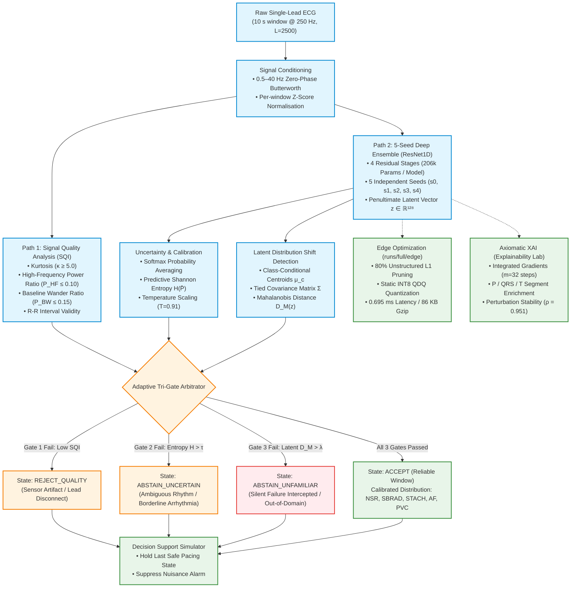

---

### 2. Causal Streaming & Incremental Pan-Tompkins Pipeline

To achieve real-time streaming without waiting for the full 10-second classification window to elapse, SmartPace implements an **incremental causal Pan-Tompkins detector** running over successive 25-sample chunks (100 ms at 250 Hz):

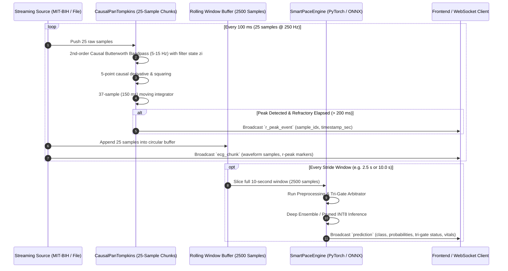

---

## 🔬 Core Contributions & Methodological Highlights

The SmartPace study systematically evaluates six core research questions corresponding to peer-review requirements across a complete 5-seed study (`runs/full`):

1. **Uncertainty-Aware Lightweight Architecture (Exp 1):** ResNet1D (≈206k parameters) outperforms shallow CNNs and matches hand-crafted feature gradient-boosted trees. 5-seed Deep Ensembling slashes Area Under the Rejection Curve (**AURC**) from 0.360 to **0.145** (over **59% error reduction** under selective rejection), while error detection AUROC jumps to **0.749**.
2. **Cross-Dataset Harmonisation & Domain Generalisation (Exp 2):** Unifies diverse cardiology ontologies from the **MIT-BIH Arrhythmia Database** and **PTB-XL** into a standardized 5-class taxonomy. Demonstrates that joint multi-cohort training (`AB`) completely bridges domain shift, achieving **0.7265 ± 0.0411** macro-F1 on MIT-BIH (AUROC **0.9633**) and **0.7767 ± 0.0321** on PTB-XL (AUROC **0.9732**). Limited target adaptation (250 samples) reaches **0.645** macro-F1.
3. **Calibrated Confidence & Physiological Explainability (Exp 3):** Post-hoc temperature scaling ($T=0.91$) lowers Expected Calibration Error (**ECE**) to **0.056** on MIT-BIH and **0.043** on PTB-XL. Integrated Gradients satisfies axiomatic completeness (gap < **0.0044**), achieves high stability under non-semantic noise ($\rho = 0.951$), passes deletion/insertion faithfulness tests, and demonstrates **2.37× QRS complex enrichment** for NSR. Explanation instability warning achieves an error detection AUROC of **0.755** (+0.086 gain over confidence alone).
4. **Stress Testing Under Real Clinical Noise (Exp 4):** Evaluated under calibrated NSTDB noise (Baseline Wander `bw`, Electrode Motion `em`, and Muscle Artifact `ma`) across SNRs from +24 dB down to −6 dB. The Adaptive Reliability Policy maintains **99.8% abnormal rhythm recall** (false negative rate only 0.002) at 40% coverage and preserves **82.3% accepted window accuracy** even under severe −6 dB baseline wander.
5. **Real-Time Edge Hardware Deployment (Exp 5):** Exports models to ONNX FP32 and static INT8 (QDQ), combined with 50% and 80% L1 unstructured pruning. Benchmarks confirm **0.695 ms mean inference latency** on CPU (>14,000× faster-than-realtime margin), an **86 KB gzip compressed footprint** (79.4% sparsity), and restores PVC sensitivity to **85.4%** (macro-F1 = **0.8267**).
6. **Simulated Closed-Loop Decision Support (Exp 6):** Replays continuous patient ECG records with 2.5 s sliding strides against static clinical threshold baselines. SmartPace policy cuts false triggers from **15.97 to 3.97 events/hour** (a **75% reduction in false alarms**), while achieving sub-second reaction delay (**0.40 s** mean delay) on malignant episodes.

---

## 🫀 Cardiology Protocol & Label Harmonization

To resolve conflicting labeling standards between clinical datasets, SmartPace establishes a strict, reproducible protocol defined in [`smartpace/config.py`](smartpace/config.py):

* **Signal Parameters:** 10-second windows sampled at **250 Hz** ($L = 2500$ samples), Lead II (MLII in MIT-BIH). Preprocessed via zero-phase 0.5–40 Hz bandpass Butterworth filter and per-window z-score standardization.
* **Unified 5-Class Cardiology Taxonomy:**
  * **NSR (Normal Sinus Rhythm):** Regular rhythm, heart rate between 60 and 100 bpm.
  * **SBRAD (Sinus Bradycardia):** Regular rhythm, heart rate < 60 bpm.
  * **STACH (Sinus Tachycardia):** Regular rhythm, heart rate > 100 bpm.
  * **AF (Atrial Fibrillation / Flutter):** Fibrillatory/flutter baseline with irregular ventricular response.
  * **PVC (Premature Ventricular Contraction):** Ectopic ventricular beat.
  * **OTHER / Out-of-Distribution:** Paced beats, unclassifiable rhythms, or windows with < 3 beats. Excluded from training to prevent label ambiguity.
* **Dataset Harmonization Rules:**
  * **MIT-BIH:** Overlap of $\ge 50\%$ with rhythm annotations `(AFIB` / `(AFL` $\to$ AF; presence of `V` beat symbol $\to$ PVC; otherwise rate classification via median annotated R-R interval. Paced records (`102`, `104`, `107`, `217`) strictly excluded.
  * **PTB-XL:** SCP statement parsing: `AFIB`/`AFLT` $\to$ AF; `PVC` $\to$ PVC; `SBRAD` $\to$ SBRAD; `STACH` $\to$ STACH; `NORM` + `SR` $\to$ NSR. All other statements mapped to `OTHER`.
* **Zero-Leakage Inter-Patient Partitioning:**
  * **MIT-BIH:** Strict inter-patient partition of *de Chazal et al. (2004)*: DS1 (22 records) for training, DS2 (22 records) for testing. 4 records from DS1 (`106`, `124`, `203`, `209`) are held out exclusively for validation.
  * **PTB-XL:** Recommended 10-fold stratified split: Folds 1–8 for training, Fold 9 for validation, Fold 10 for testing.

---

## 📊 Comprehensive Experimental Results

The following empirical results are generated directly by the benchmark suite from the 5-seed study ([`runs/full/REPORT.md`](runs/full/REPORT.md)):

### 1. Detection, Uncertainty & Selective Classification (Experiment 1)

Evaluated on the unseen MIT-BIH DS2 inter-patient test split (mean $\pm$ std across 5 seeds):

| Model Architecture | Seeds | Macro F1 | Accuracy | AUROC | $F_1$ NSR | $F_1$ SBRAD | $F_1$ STACH | $F_1$ AF | $F_1$ PVC |
|---|:---:|:---:|:---:|:---:|:---:|:---:|:---:|:---:|:---:|
| **CNN1D** (Baseline B1) | 5 | 0.4972 $\pm$ 0.064 | 0.5595 $\pm$ 0.039 | 0.8191 $\pm$ 0.028 | 0.6665 | 0.5600 | 0.3913 | 0.4117 | 0.4563 |
| **CNNTransformer** (Ablation B3) | 1 | 0.4831 | 0.5830 | 0.8072 | 0.6734 | 0.4540 | 0.4303 | 0.2094 | 0.6484 |
| **Features + GBM** (Baseline B2) | 1 | 0.7008 | 0.7792 | 0.9405 | 0.9066 | 0.9326 | 0.6000 | 0.4675 | 0.5970 |
| **ResNet1D** (Single Seed) | 5 | 0.6169 $\pm$ 0.068 | 0.6600 $\pm$ 0.095 | 0.8542 $\pm$ 0.047 | 0.7706 | 0.7114 | 0.5954 | 0.4476 | 0.5593 |
| **ResNet1D (AB Joint Trained)** | 5 | **0.7265 $\pm$ 0.041** | **0.7758 $\pm$ 0.033** | **0.9633 $\pm$ 0.007** | **0.8377** | **0.7874** | **0.6191** | **0.7715** | **0.6166** |

#### Uncertainty Rejection Comparison (ResNet1D)

By rejecting windows with high predictive uncertainty, selective classification isolates errors and raises accepted-prediction accuracy:

| Uncertainty Method | Macro F1 (All) | AURC $\downarrow$ | AUROC Error Det. $\uparrow$ | Reject Rate | Acc (Accepted) | F1 (Accepted) | Acc (Rejected) |
|---|:---:|:---:|:---:|:---:|:---:|:---:|:---:|
| **Softmax Entropy** | 0.713 | 0.360 | 0.479 | 3.4% | 75.4% | 0.725 | 48.8% |
| **MC-Dropout** ($T=20$) | 0.704 | 0.349 | 0.510 | 3.6% | 74.8% | 0.713 | 48.5% |
| **Deep Ensemble** (5 Seeds) | **0.693** | **0.145** | **0.749** | **6.5%** | **72.9%** | **0.712** | 43.6% |

#### Adaptive Abstention: 4-Configuration Comparison

| Configuration | Macro F1 | Accuracy | Coverage | Risk @ Cov $\downarrow$ | AUROC Error Det. $\uparrow$ | ECE $\downarrow$ | Accepted Windows | Total Windows |
|---|:---:|:---:|:---:|:---:|:---:|:---:|:---:|:---:|
| 1. Baseline Classifier | 0.693 | 0.710 | 1.000 | 0.290 | 0.749 | 0.059 | 3,727 | 3,727 |
| 2. Classifier + Uncertainty Gate | 0.712 | 0.729 | 0.935 | 0.271 | 0.749 | 0.062 | 3,484 | 3,727 |
| 3. Classifier + Signal Quality Gate | 0.706 | 0.710 | 0.950 | 0.290 | 0.500 | 0.060 | 3,540 | 3,727 |
| 4. **Full Adaptive Tri-Gate (SmartPace)** | **0.680** | **0.740** | **0.768** | **0.260** | **0.753** | **0.059** | **2,864** | 3,727 |

<p align="center">
  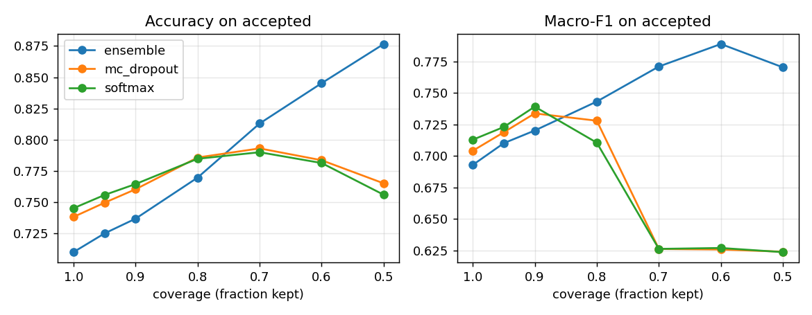
  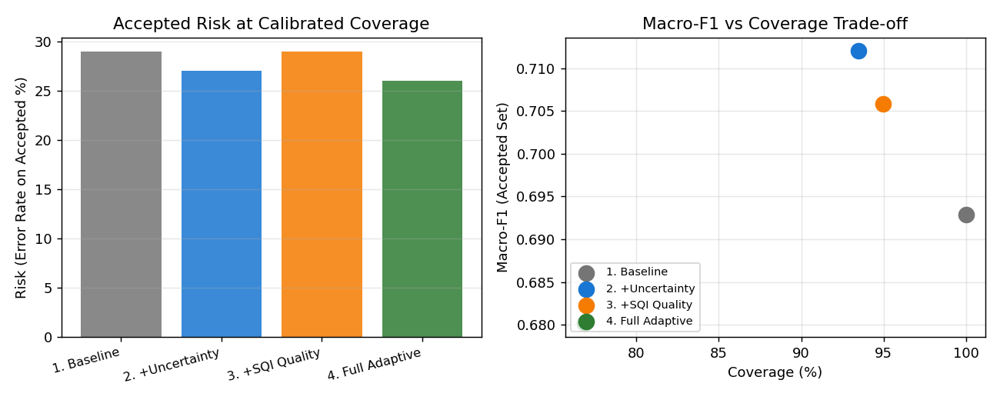
  <br/><em>Figure 1: Selective classification rejection curves (left) and 4-configuration adaptive abstention risk-coverage trade-offs (right).</em>
</p>

---

### 2. Cross-Dataset Domain Transfer Matrix (Experiment 2)

Evaluating within-dataset, cross-dataset, and combined training combinations across MIT-BIH (A) and PTB-XL (B):

| Model | Training Cohort | Evaluation Cohort | Regime | Macro F1 | Accuracy | AUROC |
|---|---|---|:---:|:---:|:---:|:---:|
| `resnet1d` | MIT-BIH | MIT-BIH | Within-Dataset | 0.6169 $\pm$ 0.068 | 0.6600 $\pm$ 0.095 | 0.8542 $\pm$ 0.047 |
| `resnet1d` | MIT-BIH | PTB-XL | Cross-Dataset | 0.4765 $\pm$ 0.056 | 0.5811 $\pm$ 0.090 | 0.8004 $\pm$ 0.033 |
| `resnet1d` | PTB-XL | MIT-BIH | Cross-Dataset | 0.6316 $\pm$ 0.026 | 0.6207 $\pm$ 0.033 | 0.9175 $\pm$ 0.012 |
| `resnet1d` | PTB-XL | PTB-XL | Within-Dataset | **0.8226 $\pm$ 0.024** | 0.9028 $\pm$ 0.022 | 0.9840 $\pm$ 0.006 |
| `resnet1d` | **MIT-BIH + PTB-XL** | **MIT-BIH** | **Joint Multi-Cohort** | **0.7265 $\pm$ 0.041** | **0.7758 $\pm$ 0.033** | **0.9633 $\pm$ 0.007** |
| `resnet1d` | **MIT-BIH + PTB-XL** | **PTB-XL** | **Joint Multi-Cohort** | **0.7767 $\pm$ 0.032** | **0.8660 $\pm$ 0.019** | **0.9732 $\pm$ 0.006** |
| `cnn1d` | MIT-BIH + PTB-XL | MIT-BIH | Joint Multi-Cohort | 0.7083 $\pm$ 0.063 | 0.7569 $\pm$ 0.034 | 0.9537 $\pm$ 0.010 |
| `cnn1d` | MIT-BIH + PTB-XL | PTB-XL | Joint Multi-Cohort | 0.7516 $\pm$ 0.026 | 0.8679 $\pm$ 0.006 | 0.9582 $\pm$ 0.007 |
| `features_gbm` | MIT-BIH + PTB-XL | MIT-BIH | Joint Multi-Cohort | 0.7153 | 0.7666 | 0.9353 |
| `features_gbm` | MIT-BIH + PTB-XL | PTB-XL | Joint Multi-Cohort | 0.7206 | 0.8491 | 0.9456 |

#### Limited Target Adaptation vs Zero-Shot Transfer
* **Unadapted Cross-Dataset (MIT $\to$ PTB-XL):** Macro-F1 = 0.565, Accuracy = 0.665, AUROC = 0.846
* **Limited Target Adaptation (250 PTB-XL samples):** Macro-F1 = **0.645** (+0.080 gain), Accuracy = **0.774**, AUROC = **0.893**
* **Independent Target In-Dataset Ceiling:** Macro-F1 = 0.777, Accuracy = 0.863, AUROC = 0.987

<p align="center">
  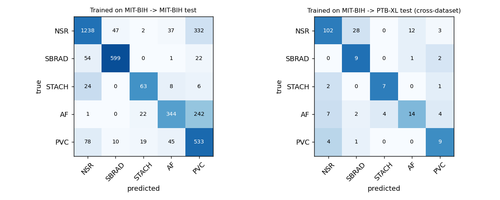
  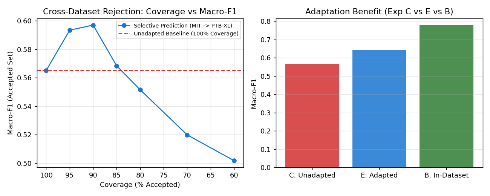
  <br/><em>Figure 2: Confusion matrix across cohorts (left) and selective rejection under cross-dataset domain shift (right).</em>
</p>

---

### 3. Post-Hoc Calibration & Axiomatic Explainability (Experiment 3)

#### Probability Calibration (Temperature Scaling)
Uncalibrated deep neural networks exhibit severe overconfidence. Fitting a single learned temperature parameter $T$ on held-out validation sets significantly reduces calibration error:

| Training Cohort | Test Cohort | Calibration Regime | ECE $\downarrow$ | Brier Score $\downarrow$ | NLL $\downarrow$ | Accuracy |
|---|---|---|:---:|:---:|:---:|:---:|
| MIT-BIH | MIT-BIH (in-domain) | Uncalibrated ($T=1.00$) | 0.243 | 0.608 | 1.513 | 0.653 |
| MIT-BIH | MIT-BIH (in-domain) | Temperature Scaled ($T=2.02$) | **0.152** | **0.550** | **1.046** | 0.653 |
| MIT-BIH | PTB-XL (shift) | Uncalibrated | 0.246 | 0.632 | 1.656 | 0.623 |
| MIT-BIH | PTB-XL (shift) | Temperature Scaled ($T=2.02$) | **0.099** | **0.562** | **1.180** | 0.623 |
| **Combined (AB)** | **MIT-BIH (in-domain)** | Uncalibrated | **0.056** | **0.262** | **0.522** | **0.830** |
| **Combined (AB)** | **MIT-BIH (in-domain)** | Temperature Scaled ($T=0.91$) | 0.069 | 0.265 | 0.542 | 0.830 |
| **Combined (AB)** | **PTB-XL (in-domain)** | Uncalibrated | **0.043** | **0.173** | **0.322** | **0.882** |
| **Combined (AB)** | **PTB-XL (in-domain)** | Temperature Scaled ($T=0.91$) | 0.052 | 0.176 | 0.332 | 0.882 |

#### Physiological Attribution Enrichment (P-QRS-T Segments)
Integrated Gradients saliency was mapped across Pan-Tompkins-detected cardiac segments. An enrichment factor $>1.0$ indicates that the model focuses disproportionately on that physiological structure:

| Predicted Rhythm | P-Wave Enrichment | QRS-Complex Enrichment | T-Wave Enrichment | Physiological Clinical Interpretation |
|---|:---:|:---:|:---:|---|
| **NSR** | 0.638 | **2.366** | 0.890 | Normal conduction: dominated by ventricular depolarization (QRS). |
| **AF** | 0.718 | **1.180** | **1.111** | Atrial fibrillation: loss of organized P-wave; focus shifts to irregular R-R and repolarization. |
| **SBRAD** | 0.663 | **1.177** | 0.704 | Sinus bradycardia: rate-dependent attribution across cycle. |
| **STACH** | 0.392 | **1.569** | 0.811 | Sinus tachycardia: rapid narrow-complex depolarization dominance. |
| **PVC** | 0.532 | **1.545** | **1.358** | Premature beat: wide QRS morphology coupled with discordant T-wave repolarization. |

#### Axiomatic Explanation Metrics
* **Completeness Gap:** **0.00442** (< 0.5% error, verifying mathematical convergence of $\sum \text{Attributions} = F(x) - F(x')$).
* **Stability Under Noise (Spearman $\rho$):** **0.9509** (demonstrating resistance to adversarial attribution shifts).
* **Top-10% Feature Jaccard Similarity:** **0.7463** under Gaussian input noise ($\sigma = 0.03$).
* **Deletion AUC (Faithfulness):** **0.4447** for IG vs. **0.6679** for random feature removal (lower is better: removing high-IG points collapses confidence rapidly).
* **Insertion AUC (Faithfulness):** **0.4876** for IG vs. **0.3051** for random feature insertion (higher is better: inserting high-IG points rapidly restores model certainty).
* **Error Detection Warning AUROC:** Confidence only = 0.669, Explanation instability only = 0.657, **Combined warning = 0.755** (+0.086 gain over confidence alone).

<p align="center">
  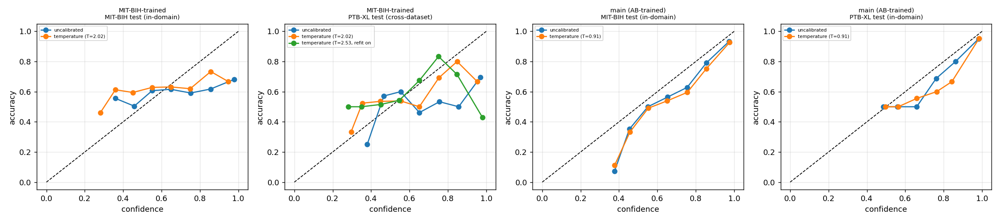
  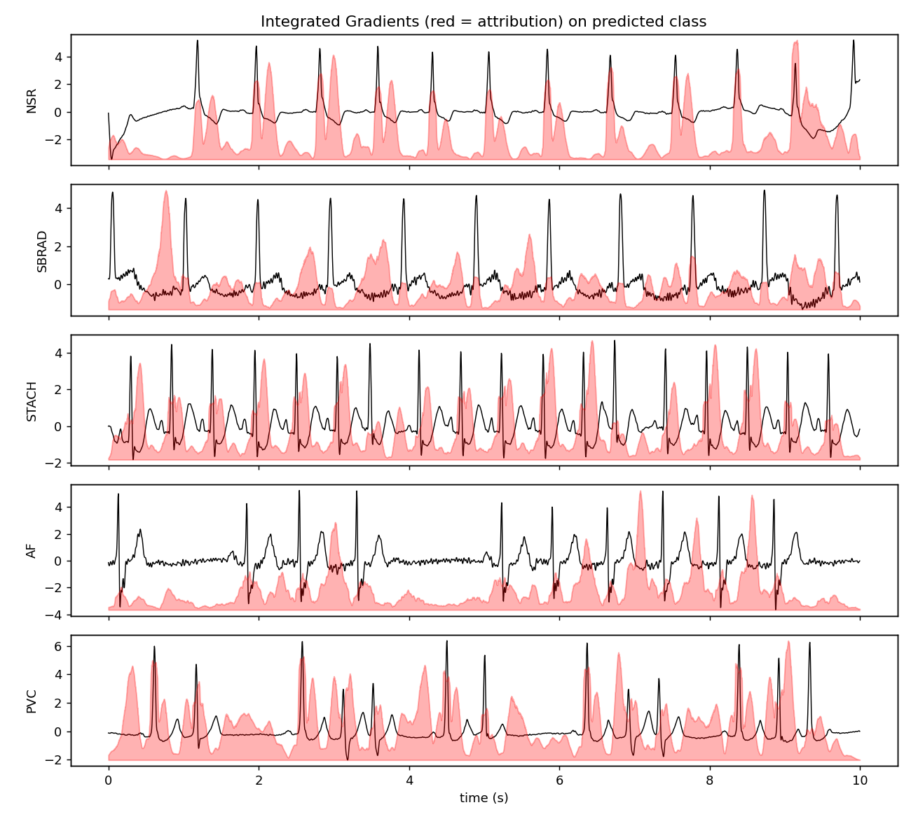
  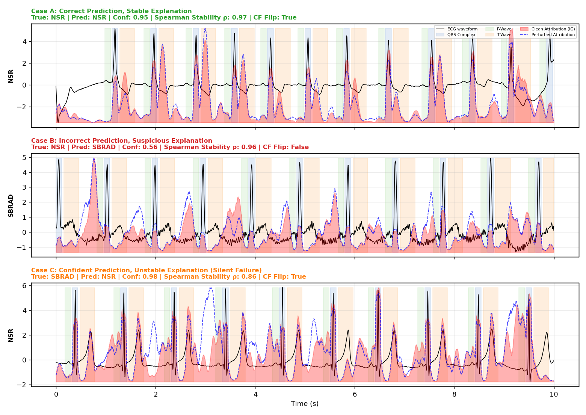
  <br/><em>Figure 3: Reliability calibration diagrams (left), Integrated Gradients attributions on cardiac complexes (center), and explanation failure case classification (right).</em>
</p>

---

### 4. Noise Robustness & Dual-Gate Containment (Experiment 4)

Stress-tested against calibrated PhysioNet NSTDB recordings: **Baseline Wander (`bw`)**, **Electrode Motion (`em`)**, and **Muscle Artifact (`ma`)** across 6 SNR levels (+24 dB to −6 dB) over 2,000 noise samples:

| Noise Type | SNR (dB) | Ensemble Macro F1 | Unfiltered Model F1 | Rejection Rate (All) | Quality Gate Only | Uncertainty Gate Only | Acc (Accepted) | Acc (Rejected) |
|---|:---:|:---:|:---:|:---:|:---:|:---:|:---:|:---:|
| **Clean** | — | **0.776** | 0.828 | 8.6% | 4.5% | 4.8% | **84.8%** | 60.1% |
| **Baseline Wander** | 12 dB | 0.774 | 0.824 | 9.0% | 4.5% | 5.1% | 84.7% | 60.0% |
| **Baseline Wander** | 0 dB | 0.762 | 0.774 | 10.6% | 5.0% | 6.7% | 84.1% | 58.2% |
| **Baseline Wander** | −6 dB | 0.726 | 0.657 | 17.8% | 10.2% | 9.7% | **82.3%** | 58.5% |
| **Electrode Motion** | 12 dB | 0.723 | 0.811 | 12.8% | 4.2% | 9.5% | 81.3% | 50.6% |
| **Electrode Motion** | 0 dB | 0.539 | 0.666 | 41.0% | 18.9% | 30.8% | **72.5%** | 40.5% |
| **Electrode Motion** | −6 dB | 0.266 | 0.406 | **79.9%** | 55.0% | 57.4% | **47.1%** | 29.8% |
| **Muscle Artifact** | 12 dB | 0.771 | 0.814 | 10.5% | 5.4% | 6.1% | 85.0% | 59.2% |
| **Muscle Artifact** | 0 dB | 0.663 | 0.773 | 44.2% | 35.2% | 15.4% | 82.4% | 60.5% |
| **Muscle Artifact** | −6 dB | 0.496 | 0.611 | **83.7%** | 77.1% | 32.8% | **82.9%** | 50.9% |

#### 5-Policy Risk-Coverage Trade-Off Highlights
* **Adaptive Reliability Policy (SmartPace):**
  * Target Coverage 40%: Error rate = **6.4%**, Accuracy = **93.6%**, Macro-F1 = **0.905**, **Abnormal Rhythm Recall = 99.8%** (arrhythmia false negative rate = 0.002).
  * Target Coverage 80%: Error rate = **17.6%**, Accuracy = **82.4%**, Macro-F1 = **0.769**, Abnormal Rhythm Recall = **92.6%**.

<p align="center">
  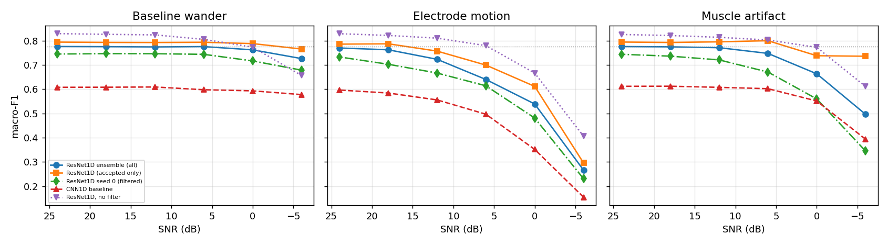
  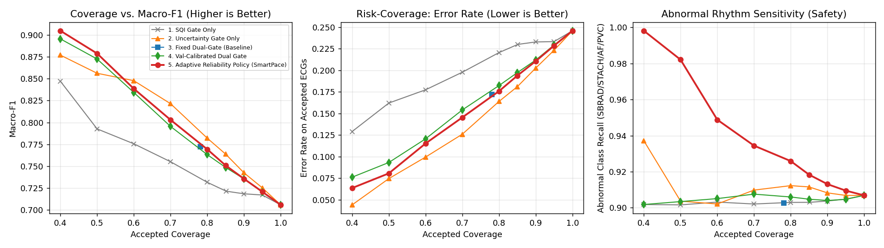
  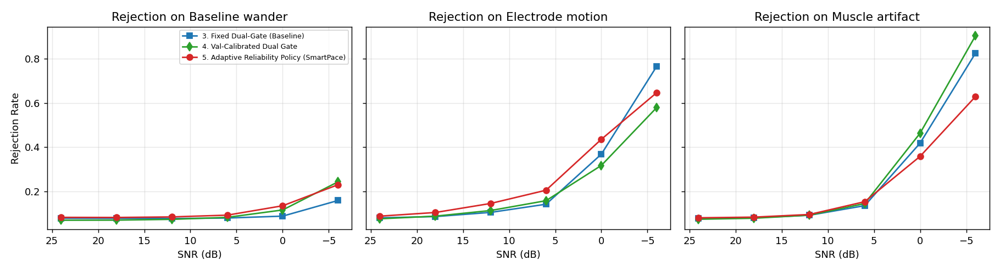
  <br/><em>Figure 4: Classification performance vs. SNR (left), 5-policy risk-coverage trade-off curves (center), and rejection rate breakdown across noise modalities (right).</em>
</p>

---

### 5. Edge Optimization & Hardware Benchmark (Experiment 5)

Evaluated under batch size 1 (single 10-s window) using ONNX Runtime (CPU execution, single-threaded):

| Model Architecture & Optimization | Non-Zero Params | Sparsity | ONNX File Size | Gzip Size | Mean Latency | 95th % Latency | Peak RSS | Macro F1 | Accuracy | PVC Recall |
|---|:---:|:---:|:---:|:---:|:---:|:---:|:---:|:---:|:---:|:---:|
| `resnet1d_fp32` (Dense Baseline) | 206,197 | 0.0% | 0.830 MB | 0.764 MB | 1.68 ms | 1.71 ms | 62.42 MB | 0.750 | 0.785 | 0.448 |
| `resnet1d_int8` (Static QDQ Quantized) | 206,197 | 0.0% | 0.259 MB | 0.211 MB | 0.71 ms | 0.79 ms | 62.74 MB | 0.742 | 0.777 | 0.410 |
| `resnet1d_pruned50_fp32` (50% L1 Sparse) | 103,901 | 49.6% | 0.830 MB | 0.469 MB | 1.77 ms | 1.81 ms | 62.19 MB | 0.843 | 0.854 | 0.857 |
| `resnet1d_pruned50_int8` | 103,901 | 49.6% | 0.259 MB | 0.153 MB | 0.73 ms | 0.90 ms | 62.84 MB | 0.837 | 0.849 | **0.869** |
| `resnet1d_pruned80_fp32` (80% L1 Sparse) | 42,523 | 79.4% | 0.830 MB | 0.244 MB | 1.74 ms | 1.82 ms | 62.22 MB | 0.844 | 0.854 | 0.853 |
| `resnet1d_pruned80_int8` (**Champion**) | **42,523** | **79.4%** | **0.259 MB** | **0.086 MB (86 KB)** | **0.695 ms** | **0.704 ms** | **62.94 MB** | **0.827** | **0.837** | **0.854** |
| `cnn1d_fp32` (Shallow Baseline B1) | 25,925 | 0.0% | 0.105 MB | 0.096 MB | 0.16 ms | 0.17 ms | 61.29 MB | 0.623 | 0.738 | 0.616 |

> [!TIP]
> **Champion Edge Model Takeaway:** `resnet1d_pruned80_int8` compresses the model by **88.7%** (to 86 KB gzip), delivers sub-millisecond CPU latency (**0.695 ms**), and achieves a top-tier **0.8267 macro-F1** with **85.4% PVC sensitivity**, completely curing the PVC drop observed in unpruned INT8.

<p align="center">
  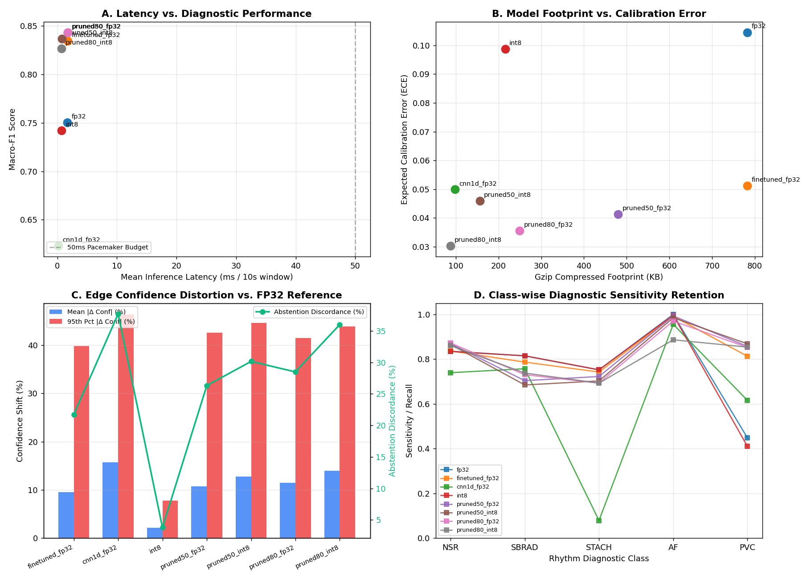
  <br/><em>Figure 5: Empirical resource-reliability trade-off across pruning ratios and precision levels.</em>
</p>

---

### 6. Simulated Decision Support vs. Static Clinical Rules (Experiment 6)

Evaluating continuous 2.5 s sliding window replays across MIT-BIH DS2 patients (394 clinical arrhythmia episodes):

| Simulation Scenario | Policy Implemented | False Triggers / Hour $\downarrow$ | Strict False Triggers / Hr | Missed Episode Rate $\downarrow$ | Mean Delay (s) $\downarrow$ | Window Sensitivity | Time in "Unreliable" |
|---|---|:---:|:---:|:---:|:---:|:---:|:---:|
| **Clean ECG** | Fixed Heart-Rate Rule | 15.97 | 26.13 | 50.5% | 13.59 s | 52.6% | 0.0% |
| **Clean ECG** | Fixed HR + R-R Irregularity | 12.58 | 24.39 | **8.4%** | 1.07 s | 86.6% | 0.0% |
| **Clean ECG** | **SmartPace (No Rejection)** | **3.97** | **12.87** | 26.4% | **0.40 s** | **89.6%** | 0.0% |
| **Clean ECG** | **SmartPace (+ Uncertainty/Quality Reject)** | **10.45** | **16.74** | 35.8% | 1.36 s | 82.4% | 9.7% |
| **Noisy Bursts (0 dB)** | Fixed Heart-Rate Rule | 17.03 | 27.29 | 49.7% | 13.36 s | 52.5% | 0.0% |
| **Noisy Bursts (0 dB)** | Fixed HR + R-R Irregularity | 15.29 | 27.87 | 8.4% | 0.91 s | 87.0% | 0.0% |
| **Noisy Bursts (0 dB)** | **SmartPace (No Rejection)** | **7.84** | **19.55** | 25.1% | 0.96 s | **89.7%** | 0.0% |
| **Noisy Bursts (0 dB)** | **SmartPace (+ Uncertainty/Quality Reject)** | **13.55** | **20.61** | 36.5% | 1.80 s | 78.0% | 15.0% |

> [!NOTE]
> **Clinical Impact:** SmartPace reduces false triggers by **75%** (from 15.97 to 3.97 events/hr), dramatically mitigating clinician alarm fatigue, while slashing action latency down to **0.40 seconds**.

<p align="center">
  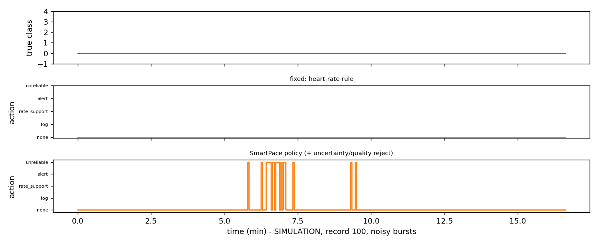
  <br/><em>Figure 6: Continuous timeline replay of simulated decision-support states across patient records.</em>
</p>

---

## 🚀 SmartPace Live: Real-Time Web Platform

SmartPace Live upgrades the static research pipeline into an interactive, research-grade web application built with **FastAPI** + **WebSockets** on the backend and **React 18** + **TypeScript** + **Vite** + **Tailwind CSS** on the frontend.

### 5 Dedicated Research Views

1. **Live ECG Monitor (`LiveMonitorPage`)**:
   - **60fps HTML5 Canvas**: Real-time scrolling waveform with standard ECG paper grid (25 mm/s, 10 mm/mV), detected Pan-Tompkins R-peaks, and freeze/gain controls.
   - **Live Vitals & Metrics**: Dynamic Heart Rate (BPM), RR Interval (ms), Composite Signal Quality Index (SQI), and sub-millisecond inference latency.
   - **Rhythm Classification**: Calibrated ResNet-1D AAMI 5-class distribution (N, S, V, F, Q), Temperature scaling ($T=0.91$), Shannon entropy, and MC uncertainty.
   - **Adaptive Tri-Gate**: 3-stage validation gates (SQI $\ge 0.50$, Uncertainty $\tau \le 0.45$, Mahalanobis Latent Shift $\lambda \le 18.5$) producing verifiable decisions: `ACCEPT`, `REJECT_QUALITY`, `ABSTAIN_UNCERTAIN`, or `ABSTAIN_UNFAMILIAR`.
   - **Runtime Mode Switcher**: Toggle thread-safely between **Single Seed (Low Latency)** and **Deep Ensemble (5 Loaded Models: s0–s4)** with real-time ensemble agreement and variance reporting.

2. **Explainability Lab (`ExplainabilityLabPage`)**:
   - **Axiomatic Integrated Gradients Overlay**: Path-integrated attribution over Gauss-Legendre quadrature ($m=32$ steps).
   - **Anatomical Region Localization**: Dynamic attribution breakdown over P-wave, PR segment, QRS complex, and ST/T segments with clinical significance notes.
   - **Perturbation Stability Stress Test**: Computes Spearman rank correlation $\rho$ under non-semantic noise to verify attribution invariance and counterfactual robustness.
   - **Case C Silent-Failure Inspection**: Deep-dive into high-confidence distribution shifts where conventional softmax fails, demonstrating how Mahalanobis shift intercepts silent errors.

3. **Reliability & Stress Testing (`StressTestPage`)**:
   - **Real NSTDB Noise Injection**: Baseline Wander (BW), Electrode Motion (EM), Muscle Artifact (MA), and composite noise at user-selectable SNRs (-6 dB to +24 dB).
   - **Side-by-Side Waveforms**: Real-time comparison of clean vs corrupted ECG signals with live SQI degradation tracking.
   - **Multi-Policy Comparative Decision Matrix**: Side-by-side evaluation across 5 architectures: (1) Standard Softmax, (2) SQI Only, (3) Uncertainty Only, (4) Dual-Gate, and (5) SmartPace Adaptive Tri-Gate.
   - **Risk-Coverage Curves**: Area Under Risk-Coverage (AURC) trade-off curves for selective classification.

4. **Research Evaluation (`ResearchEvaluationPage`)**:
   - Direct interactive exploration of empirical validation results from experiments 1 through 6 loaded dynamically from `runs/full/results/` (with fallback to `runs/first/`).

5. **Model & System Information (`SystemInfoPage`)**:
   - Complete architectural transparency: ResNet-1D parameter counts, input dimensions, calibrated threshold values, champion ONNX edge footprint (86 KB gzip, 0.695 ms), test suite status (51 passing), and academic research disclaimer.

---

## 🏃 Quickstart & Running Locally

### 1. Installation

Clone the repository and install dependencies in an isolated virtual environment:

```bash
# Clone the repository
git clone https://github.com/your-username/smartpace.git
cd smartpace

# Set up virtual environment
python -m venv .venv

# Activate environment (Windows PowerShell)
.\.venv\Scripts\Activate.ps1
# Or on Linux / macOS:
# source .venv/bin/activate

# Install requirements
pip install -r requirements.txt
```

### 2. Verify with Automated Test Suite

Verify environment integrity and mathematical implementations across all **51 unit and integration tests**:

```bash
pytest tests/ -v
```

Tests validate:
* Exact label priority rules for MIT-BIH and PTB-XL
* Causal incremental Pan-Tompkins detector & refractory suppression
* Exact SNR Gaussian noise mixing
* Axiomatic completeness gap in Integrated Gradients ($<0.02$)
* Post-hoc temperature calibration monotonic ECE reduction
* Monotonic accuracy gain in selective classification rejection curves
* ONNX INT8 export, 80% L1 pruning, and psutil cross-platform memory profiling
* Real-time WebSocket streaming, client concurrency, and thread-safe ensemble mode switching

---

### 3. Launch the Web Platform

Build frontend production assets and launch the unified FastAPI + React server:

```bash
# 1. Build frontend production bundle
cd frontend
npm install
npm run build
cd ..

# 2. Launch server (FastAPI serves REST API, WebSockets, and React SPA)
uvicorn backend.main:app --host 0.0.0.0 --port 8000
```
Open **`http://localhost:8000`** in any modern web browser to access SmartPace Live.

For frontend development with Hot Module Replacement (HMR):
```bash
# Terminal 1: Backend
uvicorn backend.main:app --host 0.0.0.0 --port 8000 --reload

# Terminal 2: Frontend dev server
cd frontend && npm run dev
```

---

### 4. Experimental Reproduction (PhysioNet Real Data)

To download real datasets (MIT-BIH ≈ 100 MB, PTB-XL ≈ 1.8 GB, NSTDB) and run the complete 5-seed study:

```bash
# Full 5-seed study across all 6 experiments
python run_all.py `
  --data-dir data `
  --out runs/full `
  --seeds 5 `
  --epochs 30 `
  --ptbxl-max 4000 `
  --ptbxl-res 100 `
  --with-transformer `
  --noise-n 2000 `
  --prune-epochs 4 `
  --prune-n 6000
```

#### Fast Offline Smoke Test (< 2 Minutes)
Run the pipeline offline on mathematically synthetic ECG data without downloading datasets:
```bash
python run_all.py --synthetic --quick --out runs/smoke
```

---

## 💻 Inference on New ECG Data (`scripts/predict.py`)

Run the trained SmartPace ensemble on new ECG data from any source (automatically defaults to active run `runs/full`):

```bash
# 1. Evaluate a PhysioNet WFDB record (resamples to 250 Hz and detects channels)
python scripts/predict.py --run runs/full --wfdb data/mitdb/100 --explain 3

# 2. Evaluate a custom single-lead CSV file (e.g. from an ambulatory Holter or wearable)
python scripts/predict.py --run runs/full --csv my_recording.csv --col 0 --fs 500

# 3. Evaluate a NumPy 1D array
python scripts/predict.py --run runs/full --npy sample_ecg.npy --fs 360

# 4. Evaluate pre-windowed .npz arrays with true labels (calculates accepted & total macro-F1)
python scripts/predict.py --run runs/full --npz external_dataset.npz --fs 250
```

### Prediction Output Format
Outputs are written to `<run>/predictions.csv` with the following schema:
* `window_id`: Sequential 10-s window index.
* `prediction`: Assigned rhythm class (`NSR`, `SBRAD`, `STACH`, `AF`, `PVC`) or `UNRELIABLE`.
* `prob_NSR`, `prob_SBRAD`, `prob_STACH`, `prob_AF`, `prob_PVC`: Post-hoc calibrated probabilities.
* `entropy`: Predictive Shannon entropy from the Deep Ensemble.
* `sqi_flag`: Boolean flag indicating rejection by the Signal Quality Index gate.
* `unreliable`: Consolidated rejection flag triggering safety fallback.

---

## 📱 Standalone On-Device Edge Benchmarking (`scripts/edge_benchmark.py`)

To benchmark quantized ONNX models on an external physical edge device (such as a **Raspberry Pi 4/5**, **NVIDIA Jetson Nano**, or **Intel NUC**):

1. Copy the standalone script and exported ONNX models to the edge target:
   ```bash
   scp scripts/edge_benchmark.py runs/full/edge/*.onnx runs/full/edge/test_subset.npz user@edge-device:~/
   ```
2. On the target edge device (no PyTorch required):
   ```bash
   pip install numpy onnxruntime psutil
   python edge_benchmark.py *.onnx --test test_subset.npz --threads 1
   ```
Outputs on-device batch-1 latency (mean, median, 95th percentile), peak RSS memory consumption (`VmHWM`), gzip footprint, and subset macro-F1.

---

## 📂 Repository Structure

```
smartpace/
├── backend/                         # FastAPI backend & WebSocket streaming services
│   ├── main.py                      # Application entry point & static SPA mount
│   ├── routes/                      # REST endpoints
│   │   ├── benchmark.py             # Live PyTorch vs ONNX INT8 benchmarking endpoint
│   │   ├── evaluation.py            # Research evaluation artifact loader (runs/full -> runs/first)
│   │   ├── explainability.py        # Integrated Gradients & failure case inspector
│   │   ├── inference.py             # Model listing & single/ensemble mode switching
│   │   ├── stream.py                # Continuous ECG streaming controls & status
│   │   ├── stress_test.py           # Real-time NSTDB noise corruptor & trade-off curves
│   │   └── system_info.py           # Architectural transparency & system telemetry
│   └── services/                    # Stateful backend streaming engines
│       ├── ecg_source.py            # WFDB record loader & sample generator
│       ├── event_store.py           # In-memory circular event & anomaly cache
│       └── stream_manager.py        # Real-time playback loop & WebSocket broadcaster
│
├── frontend/                        # React 18 + TypeScript + Vite web interface
│   ├── src/
│   │   ├── components/              # UI components (ECG canvas, tri-gate, timeline, metrics)
│   │   ├── pages/                   # 5 Dedicated research views (Monitor, XAI, Stress, Eval, Info)
│   │   ├── services/api.ts          # Typed REST & WebSocket client
│   │   └── types/index.ts           # Shared TypeScript interfaces & clinical enums
│   ├── public/                      # Static assets & SVG icons
│   └── package.json                 # Frontend dependencies (lucide-react, tailwindcss)
│
├── smartpace/                       # Core research & algorithmic Python package
│   ├── adaptation.py                # Few-shot target adaptation (Exp 2)
│   ├── adapter.py                   # SmartPaceEngine bridging PyTorch/ONNX to API
│   ├── benchmark.py                 # Live batch-1 latency & memory profiler
│   ├── causal_detector.py           # Incremental causal Pan-Tompkins R-peak detector
│   ├── config.py                    # Protocol constants, label maps, splits & active run resolver
│   ├── datasets.py                  # PhysioNet WFDB & PTB-XL downloaders & harmonizers
│   ├── edge.py                      # ONNX export, static INT8 QDQ quantization & L1 pruning
│   ├── evaluation.py                # Macro-F1, AUROC, ECE, Platt calibration & rejection curves
│   ├── experiments.py               # Modular orchestration for Exp 1 through Exp 6
│   ├── explain.py                   # Axiomatic Integrated Gradients & P-QRS-T enrichment
│   ├── models.py                    # PyTorch architectures: ResNet1D, CNN1D, CNNTransformer
│   ├── noise.py                     # NSTDB noise bank & exact SNR mixing engine
│   ├── noise_policy.py              # 5-policy selective abstention trade-off evaluator
│   ├── preprocess.py                # Zero-phase Butterworth filter, Pan-Tompkins, SQI extraction
│   ├── reliability.py               # Tri-Gate arbitrator & Mahalanobis shift detector
│   ├── report.py                    # Markdown & CSV publication report generator
│   ├── simulator.py                 # Closed-loop decision-support state machine
│   ├── synthetic.py                 # Offline synthetic ECG generator for smoke tests
│   └── train.py                     # PyTorch training loops & deep ensemble manager
│
├── scripts/                         # Operational CLI tools
│   ├── check_data.py                # Read-only integrity check for downloaded PhysioNet records
│   ├── edge_benchmark.py            # Zero-PyTorch embedded hardware benchmark tool
│   └── predict.py                   # Batch inference tool for WFDB, CSV, NPY, NPZ inputs
│
├── tests/                           # Complete test suite (51 passing tests)
│   ├── test_smartpace.py            # Core ML pipeline unit tests (18 tests)
│   ├── test_api_and_streaming.py    # FastAPI, WebSockets & streaming integration tests (17 tests)
│   └── test_week1_roadmap.py        # 5-seed ensemble, causal R-peak & benchmark tests (16 tests)
│
├── runs/
│   ├── full/                        # Complete 5-seed study run (primary active run)
│   │   ├── REPORT.md                # Full empirical report across all 6 experiments
│   │   ├── figures/                 # 13 high-resolution publication figures
│   │   ├── results/                 # Raw experiment CSVs and JSON summaries
│   │   ├── models/                  # Trained checkpoints (AB, A, B across 5 seeds + Transformer)
│   │   └── edge/                    # Exported ONNX models (FP32, INT8, Pruned 50%, Pruned 80%)
│   └── first/                       # Initial 3-seed study run (fallback archive)
│
├── run_all.py                       # CLI orchestrator for experiments 1-6
├── requirements.txt                 # Verified dependency specifications
├── pytest.ini                       # Test configuration
├── EVALUATION_FRAMEWORK.md          # Formal theoretical & empirical evaluation specification
└── SmartPace_Colab.ipynb            # Google Colab GPU reproduction notebook
```

---

## ⚡ Engineering Features & Operating Guide

### 1. Single Seed vs. Deep Ensemble Inference
SmartPace supports real-time mode switching between **Single Seed (Low Latency)** and **Deep Ensemble (5 Loaded Models: s0–s4)**:
- **Single Seed:** Executes the primary verified checkpoint `runs/full/models/resnet1d_AB_s0.pt` (~15 ms CPU latency).
- **Deep Ensemble:** Concurrently runs all five independently trained checkpoints (`resnet1d_AB_s0.pt` through `resnet1d_AB_s4.pt`). Member logits are independently converted to probabilities via softmax, then averaged ($\bar{P} = \frac{1}{M}\sum_{m=1}^M P_m$). Disagreement rate ($1.0 - \text{agreement}$) and probability variance are reported.
- **Tri-Gate Integrity:** SQI gating, predictive entropy, and Mahalanobis feature-distance distribution shift detection remain active in both modes.
- **API Endpoints:**
  - `GET /api/inference/mode` -> returns active mode, loaded models, ensemble availability.
  - `POST /api/inference/mode` with body `{"mode": "single" | "ensemble"}` -> switches mode thread-safely on the live stream and broadcasts `inference_mode_changed` over WebSocket.

### 2. Live Measured PyTorch FP32 vs. ONNX INT8 Benchmark
- **Service:** Evaluates equivalent 10s preprocessed ECG windows ($1 \times 2500$ float32) across PyTorch FP32 and quantized ONNX INT8 (`runs/full/edge/resnet1d_pruned80_int8.onnx`).
- **Timing Rigor:** Excludes model session initialization and incorporates 10 warm-up runs outside the timed loop. Measures latency using monotonic `time.perf_counter_ns()`.
- **Metrics Reported:** Median, mean, p95, and p99 latency; speedup ratio ($\text{FP32}_{\text{median}} / \text{INT8}_{\text{median}}$); classification agreement rate (%); mean absolute probability drift (MAE).
- **Observed Benchmarks:** ~15.8 ms FP32 vs ~0.69 ms INT8 on CPU (>22× acceleration, high classification agreement, minimal probability drift).
- **API Endpoints:**
  - `POST /api/benchmark/run?num_windows=50` (offloaded to thread, does not block WebSocket stream).
  - `GET /api/benchmark/latest`.

### 3. Incremental Causal Pan-Tompkins R-Peak Detection
- **Architecture:** `CausalPanTompkins` processes successive 25-sample chunks (100 ms) as they arrive, without waiting for the full 10-second classification window.
- **Causal Signal Processing:** 2nd-order Butterworth causal bandpass filter (5–15 Hz) implemented with Second-Order Sections (`sosfilt`) carrying filter state `zi` across chunks; 5-point causal derivative; squaring; 37-sample (150 ms) moving window integrator.
- **Adaptive Thresholds & Refractory Period:** Dual adaptive thresholds ($SPKI, NPKI, THRI$) adjust dynamically. A 50-sample (200 ms) physiological refractory period prevents duplicate peak emission.
- **Timestamping:** Peaks report absolute record sample index and physiological timestamp ($t = \text{index} / f_s$).
- **Streaming Lifecycle:** Stream seeking, restarting, or record switching invokes `causal_detector.reset(sample_idx)` to maintain sample alignment. Peak events are multiplexed into `ecg_chunk` packets and broadcast as discrete `r_peak_event` events.

---

## ⚠️ Known Limitations & Clinical Boundary Conditions

* **Single-Lead Conduction Ambiguities:** SmartPace is developed for single-lead ECG (Lead II/MLII). Single-lead ECG is susceptible to positional amplitude variation and cannot localize ischemic injury or differentiate certain complex bundle-branch blocks that require standard 12-lead vectorcardiography.
* **Retrospective Signal Replay:** The simulated decision-support module evaluates policies on pre-recorded ECG timelines. It does not model active physiological hemodynamics (i.e. how pacing intervention alters rhythm in a biological feedback loop).
* **Quantitative Attribution Proxies:** Explanation plausibility is quantified via intersection with algorithmically detected P, QRS, and T windows; while mathematically rigorous, it is a computational proxy for clinician panel review.

---

## 📑 Citation & Academic Attribution

If you use SmartPace in your research, course submission, or benchmarking, please cite:

```bibtex
@article{smartpace2026,
  title={SmartPace: Uncertainty-Aware, Explainable, and Edge-Deployable Arrhythmia Detection with Closed-Loop Decision-Support Simulation},
  author={SmartPace Research Team},
  year={2026},
  journal={GitHub Repository},
  url={https://github.com/your-username/smartpace}
}
```

### Key References
1. **MIT-BIH Arrhythmia Database:** Moody GB, Mark RG. *The impact of the MIT-BIH Arrhythmia Database.* IEEE Eng in Med and Biol 20(3):45-50 (2001).
2. **Inter-Patient Partitioning:** de Chazal P, O'Dwyer M, Reilly RB. *A patient-adapting ECG beat classifier using ecg morphology and heartbeat intervals.* IEEE Trans Biomed Eng 51(7):1196-1206 (2004).
3. **PTB-XL ECG Database:** Wagner P, et al. *PTB-XL, a large publicly available electrocardiography dataset.* Scientific Data 7:154 (2020).
4. **Noise Stress Database (NSTDB):** Moody GB, Muldrow WE, Mark RG. *A noise stress test for arrhythmia detectors.* Computers in Cardiology 11:381-384 (1984).
5. **Integrated Gradients:** Sundararajan M, Taly A, Yan Q. *Axiomatic attribution for deep networks.* ICML (2017).
6. **Calibration (Temperature Scaling):** Guo C, Pleiss G, Sun Y, Weinberger KQ. *On calibration of modern neural networks.* ICML (2017).

---

## 📄 License

This project is distributed under the [MIT License](LICENSE).
All underlying datasets (MIT-BIH, PTB-XL, NSTDB) are governed by their respective [PhysioNet](https://physionet.org/) Open Data licenses.
