# SmartPace - results report

> The decision-support simulator is **not a clinically validated pacemaker controller**.

- Noise source: NSTDB
- Total run time: 28178 s

- Experiments 3-6 use the ResNet1D trained on **AB** (MIT-BIH + PTB-XL training splits). Their test sets are therefore in-domain for both datasets; the cross-dataset study is Section 2.

## 1. Detection, uncertainty and rejection (remark 1)

**MIT-BIH test (inter-patient), mean ± std over seeds**

| model | n_seeds | macro_f1 | accuracy | auroc | f1_NSR | f1_SBRAD | f1_STACH | f1_AF | f1_PVC |
|---|---|---|---|---|---|---|---|---|---|
| cnn1d | 5 | 0.4972 ± 0.0641 | 0.5595 ± 0.0394 | 0.8191 ± 0.0280 | 0.6665 ± 0.0497 | 0.5600 ± 0.1025 | 0.3913 ± 0.1873 | 0.4117 ± 0.1587 | 0.4563 ± 0.0500 |
| cnntransformer | 1 | 0.4831 | 0.5830 | 0.8072 | 0.6734 | 0.4540 | 0.4303 | 0.2094 | 0.6484 |
| features_gbm | 1 | 0.7008 | 0.7792 | 0.9405 | 0.9066 | 0.9326 | 0.6000 | 0.4675 | 0.5970 |
| resnet1d | 5 | 0.6169 ± 0.0678 | 0.6600 ± 0.0954 | 0.8542 ± 0.0471 | 0.7706 ± 0.1048 | 0.7114 ± 0.1676 | 0.5954 ± 0.0961 | 0.4476 ± 0.1535 | 0.5593 ± 0.0650 |


**Uncertainty methods (ResNet1D)**

| method | macro_f1_all | aurc | auroc_error_detection | reject_rate | acc_accepted | f1_accepted | acc_rejected |
|---|---|---|---|---|---|---|---|
| softmax | 0.713 | 0.360 | 0.479 | 0.034 | 0.754 | 0.725 | 0.488 |
| mc_dropout | 0.704 | 0.349 | 0.510 | 0.036 | 0.748 | 0.713 | 0.485 |
| ensemble | 0.693 | 0.145 | 0.749 | 0.065 | 0.729 | 0.712 | 0.436 |


**Adaptive Abstention: 4-Configuration Comparison (Signal Quality + Uncertainty + Distribution Shift)**

| configuration | macro_f1 | accuracy | coverage | risk_at_coverage | auroc_error_detection | auroc_ood_detection | ece | n_accepted | n_total |
|---|---|---|---|---|---|---|---|---|---|
| 1. Baseline Classifier | 0.693 | 0.710 | 1.000 | 0.290 | 0.749 |  | 0.059 | 3727 | 3727 |
| 2. Classifier + Uncertainty Gate | 0.712 | 0.729 | 0.935 | 0.271 | 0.749 |  | 0.062 | 3484 | 3727 |
| 3. Classifier + Signal Quality Gate | 0.706 | 0.710 | 0.950 | 0.290 | 0.500 |  | 0.060 | 3540 | 3727 |
| 4. Full Adaptive Tri-Gate (SmartPace) | 0.680 | 0.740 | 0.768 | 0.260 | 0.753 | 0.466 | 0.059 | 2864 | 3727 |


**Distribution Shift Detectors: Mahalanobis vs Centroid Baseline**

| detector | ood_auroc | val_threshold |
|---|---|---|
| Euclidean Nearest-Centroid (Baseline) | 0.552 | 11.146 |
| Mahalanobis Representation Distance (SmartPace) | 0.466 | 13.868 |

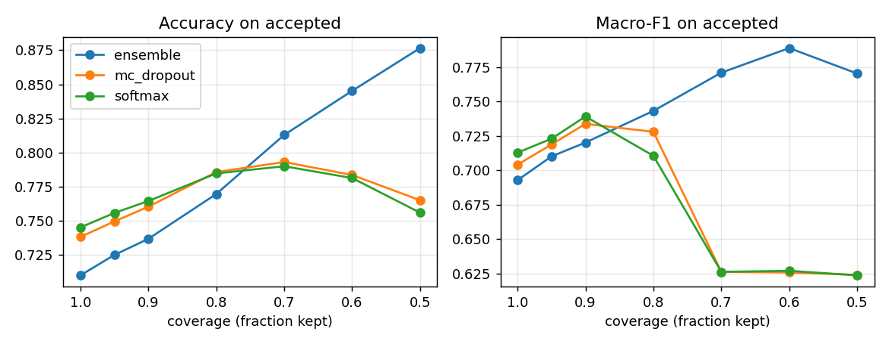

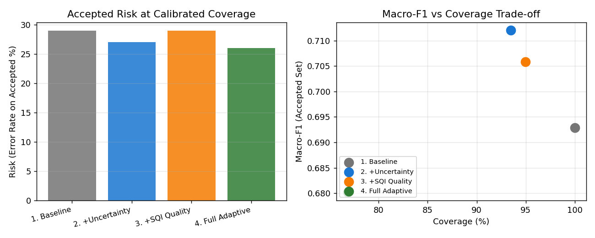

## 2. Cross-dataset generalisation (remark 2)

**Unified-label window counts**

| dataset | split | NSR | SBRAD | STACH | AF | PVC | OTHER |
|---|---|---|---|---|---|---|---|
| MIT-BIH | train | 3788 | 491 | 162 | 120 | 1352 | 567 |
| MIT-BIH | val | 199 | 190 | 26 | 179 | 62 | 64 |
| MIT-BIH | test | 1656 | 676 | 101 | 609 | 685 | 233 |
| PTB-XL | train | 1200 | 95 | 95 | 236 | 143 | 1431 |
| PTB-XL | val | 158 | 17 | 15 | 28 | 19 | 163 |
| PTB-XL | test | 145 | 12 | 10 | 31 | 14 | 188 |


**Train / test combinations**

| model | train | test | setting | macro_f1 | accuracy | auroc | f1_NSR | f1_SBRAD | f1_STACH | f1_AF | f1_PVC |
|---|---|---|---|---|---|---|---|---|---|---|---|
| resnet1d | MIT-BIH | MIT-BIH | within-dataset | 0.6169 ± 0.0678 | 0.6600 ± 0.0954 | 0.8542 ± 0.0471 | 0.7706 ± 0.1048 | 0.7114 ± 0.1676 | 0.5954 ± 0.0961 | 0.4476 ± 0.1535 | 0.5593 ± 0.0650 |
| resnet1d | MIT-BIH | PTB-XL | cross-dataset | 0.4765 ± 0.0560 | 0.5811 ± 0.0901 | 0.8004 ± 0.0333 | 0.7039 ± 0.1058 | 0.3297 ± 0.0633 | 0.5299 ± 0.0784 | 0.3541 ± 0.1318 | 0.4650 ± 0.1222 |
| cnn1d | MIT-BIH | MIT-BIH | within-dataset | 0.4972 ± 0.0641 | 0.5595 ± 0.0394 | 0.8191 ± 0.0280 | 0.6665 ± 0.0497 | 0.5600 ± 0.1025 | 0.3913 ± 0.1873 | 0.4117 ± 0.1587 | 0.4563 ± 0.0500 |
| cnn1d | MIT-BIH | PTB-XL | cross-dataset | 0.3788 ± 0.0698 | 0.5179 ± 0.1002 | 0.7396 ± 0.0355 | 0.6564 ± 0.0954 | 0.4017 ± 0.0874 | 0.2726 ± 0.0886 | 0.2677 ± 0.1475 | 0.2956 ± 0.0723 |
| features_gbm | MIT-BIH | MIT-BIH | within-dataset | 0.7008 | 0.7792 | 0.9405 | 0.9066 | 0.9326 | 0.6000 | 0.4675 | 0.5970 |
| features_gbm | MIT-BIH | PTB-XL | cross-dataset | 0.5726 | 0.7075 | 0.9051 | 0.8464 | 0.4211 | 0.7059 | 0.3243 | 0.5652 |
| resnet1d | PTB-XL | MIT-BIH | cross-dataset | 0.6316 ± 0.0263 | 0.6207 ± 0.0326 | 0.9175 ± 0.0117 | 0.5730 ± 0.0600 | 0.6160 ± 0.1622 | 0.6338 ± 0.0534 | 0.7959 ± 0.0337 | 0.5394 ± 0.0186 |
| resnet1d | PTB-XL | PTB-XL | within-dataset | 0.8226 ± 0.0235 | 0.9028 ± 0.0216 | 0.9840 ± 0.0055 | 0.9475 ± 0.0160 | 0.7046 ± 0.0549 | 0.8403 ± 0.0253 | 0.8964 ± 0.0315 | 0.7241 ± 0.0544 |
| cnn1d | PTB-XL | MIT-BIH | cross-dataset | 0.7080 ± 0.0203 | 0.7173 ± 0.0193 | 0.9354 ± 0.0051 | 0.6664 ± 0.0385 | 0.8378 ± 0.0198 | 0.6058 ± 0.0832 | 0.7149 ± 0.0247 | 0.7153 ± 0.0287 |
| cnn1d | PTB-XL | PTB-XL | within-dataset | 0.8074 ± 0.0234 | 0.8981 ± 0.0102 | 0.9615 ± 0.0048 | 0.9421 ± 0.0059 | 0.7182 ± 0.0282 | 0.7728 ± 0.0334 | 0.8903 ± 0.0175 | 0.7136 ± 0.0610 |
| features_gbm | PTB-XL | MIT-BIH | cross-dataset | 0.5889 | 0.6550 | 0.8849 | 0.7596 | 0.4609 | 0.5532 | 0.7044 | 0.4663 |
| features_gbm | PTB-XL | PTB-XL | within-dataset | 0.7855 | 0.8915 | 0.9677 | 0.9553 | 0.7826 | 0.7059 | 0.7742 | 0.7097 |
| resnet1d | MIT-BIH+PTB-XL | MIT-BIH | combined | 0.7265 ± 0.0411 | 0.7758 ± 0.0332 | 0.9633 ± 0.0066 | 0.8377 ± 0.0230 | 0.7874 ± 0.0782 | 0.6191 ± 0.0538 | 0.7715 ± 0.0809 | 0.6166 ± 0.1367 |
| resnet1d | MIT-BIH+PTB-XL | PTB-XL | combined | 0.7767 ± 0.0321 | 0.8660 ± 0.0192 | 0.9732 ± 0.0057 | 0.9203 ± 0.0132 | 0.6107 ± 0.0603 | 0.8957 ± 0.0335 | 0.8610 ± 0.0116 | 0.5959 ± 0.0881 |
| cnn1d | MIT-BIH+PTB-XL | MIT-BIH | combined | 0.7083 ± 0.0630 | 0.7569 ± 0.0338 | 0.9537 ± 0.0104 | 0.8017 ± 0.0205 | 0.7582 ± 0.0681 | 0.5624 ± 0.2289 | 0.7291 ± 0.0497 | 0.6903 ± 0.0888 |
| cnn1d | MIT-BIH+PTB-XL | PTB-XL | combined | 0.7516 ± 0.0260 | 0.8679 ± 0.0060 | 0.9582 ± 0.0072 | 0.9231 ± 0.0048 | 0.5764 ± 0.0516 | 0.7971 ± 0.0806 | 0.8725 ± 0.0160 | 0.5891 ± 0.0790 |
| features_gbm | MIT-BIH+PTB-XL | MIT-BIH | combined | 0.7153 | 0.7666 | 0.9353 | 0.8678 | 0.7867 | 0.6281 | 0.7276 | 0.5661 |
| features_gbm | MIT-BIH+PTB-XL | PTB-XL | combined | 0.7206 | 0.8491 | 0.9456 | 0.9371 | 0.6452 | 0.7059 | 0.7037 | 0.6111 |


**Experiment E: Limited Target Adaptation vs Cross-Dataset Transfer**

| experiment | macro_f1 | accuracy | auroc |
|---|---|---|---|
| Exp C: Unadapted Cross-Dataset (MIT -> PTB-XL) | 0.565 | 0.665 | 0.846 |
| Exp E: Limited Target Adaptation (250 samples) | 0.645 | 0.774 | 0.893 |
| Exp B: Independent Target In-Dataset Ceiling | 0.777 | 0.863 | 0.987 |


**Sampling Rate & Bandwidth Control Experiment**

| sampling_condition | macro_f1 | accuracy | ece |
|---|---|---|---|
| 1. Standard Harmonized (250 Hz) | 0.565 | 0.665 | 0.224 |
| 2. Bandwidth-Limited (100 Hz Sim) | 0.565 | 0.665 | 0.223 |
| 3. High-Rate Reconstructed (500 Hz Sim) | 0.565 | 0.665 | 0.224 |


**Cross-Dataset Rejection: Selective Prediction under Domain Shift**

| coverage | macro_f1 | accuracy | error_rate | ece | n_accepted |
|---|---|---|---|---|---|
| 1.000 | 0.565 | 0.665 | 0.335 | 0.224 | 212 |
| 0.950 | 0.593 | 0.692 | 0.308 | 0.230 | 201 |
| 0.900 | 0.597 | 0.707 | 0.293 | 0.227 | 191 |
| 0.850 | 0.568 | 0.706 | 0.294 | 0.237 | 180 |
| 0.800 | 0.552 | 0.706 | 0.294 | 0.243 | 170 |
| 0.700 | 0.520 | 0.730 | 0.270 | 0.235 | 148 |
| 0.600 | 0.502 | 0.740 | 0.260 | 0.232 | 127 |

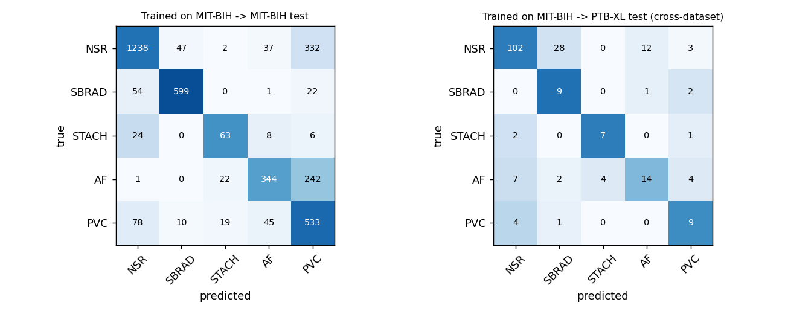

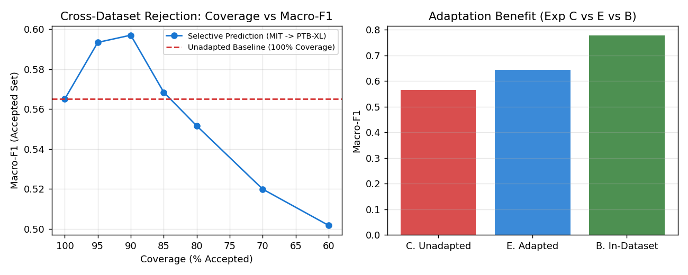

## 3. Calibration and explanations (remark 3 & Improvement 4)
Improvement 4 stress-tests explanations under physiological perturbations and counterfactuals, revealing Case C silent failures where confidence is high but attributions are fragile.

**Calibration**

| model | test_set | calibration | ece | brier | nll | accuracy |
|---|---|---|---|---|---|---|
| MIT-BIH-trained | MIT-BIH test (in-domain) | uncalibrated | 0.243 | 0.608 | 1.513 | 0.653 |
| MIT-BIH-trained | MIT-BIH test (in-domain) | temperature (T=2.02) | 0.152 | 0.550 | 1.046 | 0.653 |
| MIT-BIH-trained | PTB-XL test (cross-dataset) | uncalibrated | 0.246 | 0.632 | 1.656 | 0.623 |
| MIT-BIH-trained | PTB-XL test (cross-dataset) | temperature (T=2.02) | 0.099 | 0.562 | 1.180 | 0.623 |
| MIT-BIH-trained | PTB-XL test (cross-dataset) | temperature (T=2.53, refit on PTB-XL val) | 0.091 | 0.560 | 1.152 | 0.623 |
| main (AB-trained) | MIT-BIH test (in-domain) | uncalibrated | 0.056 | 0.262 | 0.522 | 0.830 |
| main (AB-trained) | MIT-BIH test (in-domain) | temperature (T=0.91) | 0.069 | 0.265 | 0.542 | 0.830 |
| main (AB-trained) | PTB-XL test (in-domain) | uncalibrated | 0.043 | 0.173 | 0.322 | 0.882 |
| main (AB-trained) | PTB-XL test (in-domain) | temperature (T=0.91) | 0.052 | 0.176 | 0.332 | 0.882 |


**Attribution enrichment inside P / QRS / T regions (>1 = concentrated there)**

| predicted_class | P | QRS | T |
|---|---|---|---|
| NSR | 0.638 | 2.366 | 0.890 |
| SBRAD | 0.663 | 1.177 | 0.704 |
| AF | 0.718 | 1.180 | 1.111 |
| STACH | 0.392 | 1.569 | 0.811 |
| PVC | 0.532 | 1.545 | 1.358 |


**Explanation Stress Testing & Failure Mode Classification (Cases A, B, C)**

| window_idx | true_class | predicted_class | confidence | is_correct | stability_spearman | topk_jaccard | share_qrs | share_p | share_t | physiological_share | background_share | qrs_enrichment | p_enrichment | t_enrichment | counterfactual_flip_highlighted | counterfactual_flip_control | failure_case |
|---|---|---|---|---|---|---|---|---|---|---|---|---|---|---|---|---|---|
| 0 | NSR | NSR | 0.950 | True | 0.969 | 0.805 | 0.373 | 0.048 | 0.407 | 0.827 | 0.173 | 2.589 | 0.332 | 1.233 | True | False | Case A: Correct, stable explanation |
| 1 | NSR | NSR | 0.874 | True | 0.993 | 0.859 | 0.178 | 0.177 | 0.264 | 0.619 | 0.381 | 1.237 | 1.229 | 0.732 | True | False | Case A: Correct, stable explanation |
| 2 | NSR | NSR | 0.939 | True | 0.975 | 0.661 | 0.308 | 0.025 | 0.532 | 0.865 | 0.135 | 2.334 | 0.190 | 1.626 | True | False | Case A: Correct, stable explanation |
| 3 | NSR | NSR | 0.995 | True | 0.979 | 0.938 | 0.480 | 0.044 | 0.362 | 0.886 | 0.114 | 3.336 | 0.305 | 1.004 | True | False | Case A: Correct, stable explanation |
| 4 | NSR | SBRAD | 0.556 | False | 0.957 | 0.479 | 0.147 | 0.093 | 0.156 | 0.397 | 0.603 | 1.117 | 0.777 | 0.487 | False | False | Case D: Standard / intermediate |
| 5 | NSR | NSR | 0.925 | True | 0.989 | 0.969 | 0.502 | 0.080 | 0.257 | 0.839 | 0.161 | 2.615 | 0.417 | 0.561 | False | False | Case A: Correct, stable explanation |
| 6 | NSR | AF | 0.672 | False | 0.993 | 0.916 | 0.140 | 0.104 | 0.275 | 0.519 | 0.481 | 1.164 | 0.930 | 0.917 | False | False | Case D: Standard / intermediate |
| 7 | NSR | NSR | 0.986 | True | 0.987 | 0.946 | 0.486 | 0.087 | 0.281 | 0.854 | 0.146 | 2.533 | 0.466 | 0.625 | True | False | Case A: Correct, stable explanation |
| 8 | NSR | NSR | 0.984 | True | 0.936 | 0.852 | 0.247 | 0.140 | 0.224 | 0.612 | 0.388 | 2.060 | 1.181 | 0.747 | True | False | Case A: Correct, stable explanation |
| 9 | NSR | NSR | 0.620 | True | 0.990 | 0.976 | 0.358 | 0.087 | 0.182 | 0.627 | 0.373 | 3.058 | 0.805 | 0.607 | True | False | Case A: Correct, stable explanation |
| 10 | NSR | NSR | 0.986 | True | 0.989 | 0.984 | 0.510 | 0.101 | 0.225 | 0.837 | 0.163 | 2.835 | 0.561 | 0.504 | True | False | Case A: Correct, stable explanation |
| 11 | NSR | NSR | 0.972 | True | 0.978 | 0.984 | 0.528 | 0.070 | 0.295 | 0.893 | 0.107 | 2.934 | 0.418 | 0.655 | True | False | Case A: Correct, stable explanation |
| 12 | NSR | NSR | 0.975 | True | 0.905 | 0.976 | 0.441 | 0.043 | 0.248 | 0.732 | 0.268 | 3.343 | 0.329 | 0.810 | True | False | Case A: Correct, stable explanation |
| 13 | NSR | NSR | 0.619 | True | 0.983 | 0.908 | 0.408 | 0.049 | 0.194 | 0.651 | 0.349 | 3.093 | 0.369 | 0.619 | True | False | Case A: Correct, stable explanation |
| 14 | NSR | NSR | 0.995 | True | 0.989 | 0.976 | 0.462 | 0.049 | 0.372 | 0.883 | 0.117 | 3.208 | 0.342 | 1.034 | True | False | Case A: Correct, stable explanation |
| 15 | NSR | NSR | 0.457 | True | 0.994 | 0.845 | 0.203 | 0.047 | 0.564 | 0.813 | 0.187 | 1.689 | 0.390 | 2.089 | True | False | Case A: Correct, stable explanation |
| 16 | NSR | NSR | 0.984 | True | 0.988 | 0.961 | 0.658 | 0.073 | 0.170 | 0.901 | 0.099 | 3.494 | 0.407 | 0.373 | True | False | Case A: Correct, stable explanation |
| 17 | NSR | AF | 0.711 | False | 0.989 | 0.923 | 0.126 | 0.139 | 0.228 | 0.493 | 0.507 | 0.952 | 1.053 | 0.691 | False | False | Case D: Standard / intermediate |
| 18 | NSR | NSR | 0.985 | True | 0.916 | 0.742 | 0.283 | 0.135 | 0.215 | 0.633 | 0.367 | 2.358 | 1.122 | 0.718 | True | False | Case A: Correct, stable explanation |
| 19 | NSR | NSR | 0.844 | True | 0.990 | 0.786 | 0.143 | 0.197 | 0.198 | 0.538 | 0.462 | 1.020 | 1.365 | 0.600 | True | False | Case A: Correct, stable explanation |
| 20 | SBRAD | SBRAD | 0.899 | True | 0.972 | 0.634 | 0.072 | 0.074 | 0.139 | 0.285 | 0.715 | 0.599 | 0.619 | 0.478 | False | False | Case A: Correct, stable explanation |
| 21 | SBRAD | SBRAD | 0.635 | True | 0.989 | 0.880 | 0.292 | 0.068 | 0.498 | 0.859 | 0.141 | 2.708 | 0.694 | 1.846 | False | False | Case A: Correct, stable explanation |
| 22 | SBRAD | NSR | 0.972 | False | 0.877 | 0.799 | 0.230 | 0.119 | 0.254 | 0.603 | 0.397 | 1.919 | 0.988 | 0.942 | True | False | Case D: Standard / intermediate |
| 23 | SBRAD | SBRAD | 0.885 | True | 0.950 | 0.684 | 0.106 | 0.055 | 0.208 | 0.369 | 0.631 | 0.979 | 0.511 | 0.772 | False | False | Case A: Correct, stable explanation |
| 24 | SBRAD | NSR | 0.967 | False | 0.866 | 0.706 | 0.195 | 0.110 | 0.254 | 0.559 | 0.441 | 1.673 | 0.913 | 0.943 | True | False | Case D: Standard / intermediate |
| 25 | SBRAD | SBRAD | 0.904 | True | 0.919 | 0.672 | 0.100 | 0.061 | 0.191 | 0.352 | 0.648 | 0.958 | 0.564 | 0.795 | False | False | Case A: Correct, stable explanation |
| 26 | SBRAD | SBRAD | 0.914 | True | 0.913 | 0.553 | 0.084 | 0.044 | 0.178 | 0.307 | 0.693 | 0.878 | 0.461 | 0.743 | False | False | Case A: Correct, stable explanation |
| 27 | SBRAD | NSR | 0.982 | False | 0.864 | 0.425 | 0.246 | 0.152 | 0.226 | 0.624 | 0.376 | 2.046 | 1.268 | 0.753 | True | False | Case D: Standard / intermediate |
| 28 | SBRAD | SBRAD | 0.744 | True | 0.960 | 0.838 | 0.086 | 0.124 | 0.131 | 0.342 | 0.658 | 0.718 | 1.037 | 0.438 | True | False | Case A: Correct, stable explanation |
| 29 | SBRAD | SBRAD | 0.956 | True | 0.983 | 0.779 | 0.082 | 0.063 | 0.154 | 0.299 | 0.701 | 0.685 | 0.582 | 0.513 | False | False | Case A: Correct, stable explanation |
| 30 | SBRAD | SBRAD | 0.890 | True | 0.956 | 0.618 | 0.134 | 0.059 | 0.152 | 0.345 | 0.655 | 1.240 | 0.548 | 0.632 | False | False | Case A: Correct, stable explanation |
| 31 | SBRAD | NSR | 0.961 | False | 0.976 | 0.538 | 0.268 | 0.037 | 0.281 | 0.585 | 0.415 | 2.229 | 0.306 | 0.937 | False | False | Case D: Standard / intermediate |
| 32 | SBRAD | SBRAD | 0.975 | True | 0.958 | 0.838 | 0.113 | 0.098 | 0.166 | 0.377 | 0.623 | 1.050 | 1.025 | 0.614 | False | False | Case A: Correct, stable explanation |
| 33 | SBRAD | SBRAD | 0.992 | True | 0.958 | 0.859 | 0.168 | 0.065 | 0.091 | 0.325 | 0.675 | 3.505 | 1.358 | 0.762 | False | False | Case A: Correct, stable explanation |
| 34 | SBRAD | NSR | 0.976 | False | 0.889 | 0.786 | 0.251 | 0.116 | 0.236 | 0.603 | 0.397 | 2.088 | 0.966 | 0.814 | True | False | Case D: Standard / intermediate |
| 35 | SBRAD | SBRAD | 0.843 | True | 0.976 | 0.678 | 0.070 | 0.064 | 0.147 | 0.281 | 0.719 | 0.581 | 0.533 | 0.511 | False | False | Case A: Correct, stable explanation |
| 36 | SBRAD | SBRAD | 0.958 | True | 0.980 | 0.792 | 0.072 | 0.060 | 0.128 | 0.259 | 0.741 | 0.663 | 0.553 | 0.472 | False | False | Case A: Correct, stable explanation |
| 37 | SBRAD | SBRAD | 0.903 | True | 0.946 | 0.548 | 0.081 | 0.044 | 0.229 | 0.354 | 0.646 | 0.748 | 0.432 | 0.847 | False | False | Case A: Correct, stable explanation |
| 38 | SBRAD | NSR | 0.980 | False | 0.942 | 0.667 | 0.221 | 0.133 | 0.222 | 0.577 | 0.423 | 1.842 | 1.109 | 0.741 | True | False | Case D: Standard / intermediate |
| 39 | SBRAD | SBRAD | 0.982 | True | 0.935 | 0.672 | 0.141 | 0.099 | 0.166 | 0.406 | 0.594 | 1.469 | 1.030 | 0.693 | False | False | Case A: Correct, stable explanation |
| 40 | STACH | STACH | 0.896 | True | 0.998 | 0.916 | 0.334 | 0.089 | 0.426 | 0.849 | 0.151 | 1.545 | 0.413 | 0.789 | False | False | Case A: Correct, stable explanation |
| 41 | STACH | AF | 0.991 | False | 0.996 | 0.908 | 0.183 | 0.164 | 0.451 | 0.798 | 0.202 | 1.274 | 1.138 | 1.252 | False | False | Case D: Standard / intermediate |
| 42 | STACH | STACH | 0.947 | True | 0.996 | 0.825 | 0.352 | 0.088 | 0.386 | 0.826 | 0.174 | 1.727 | 0.432 | 0.756 | False | False | Case A: Correct, stable explanation |
| 43 | STACH | STACH | 0.845 | True | 0.996 | 0.880 | 0.329 | 0.103 | 0.433 | 0.865 | 0.135 | 1.535 | 0.506 | 0.801 | True | False | Case A: Correct, stable explanation |
| 44 | STACH | STACH | 0.906 | True | 0.996 | 0.901 | 0.322 | 0.097 | 0.430 | 0.849 | 0.151 | 1.490 | 0.449 | 0.843 | False | False | Case A: Correct, stable explanation |
| 45 | STACH | AF | 0.766 | False | 0.967 | 0.866 | 0.289 | 0.179 | 0.454 | 0.923 | 0.077 | 1.606 | 1.055 | 1.009 | False | False | Case D: Standard / intermediate |
| 46 | STACH | STACH | 0.830 | True | 0.992 | 0.866 | 0.366 | 0.090 | 0.399 | 0.855 | 0.145 | 1.694 | 0.418 | 0.777 | False | False | Case A: Correct, stable explanation |
| 47 | STACH | STACH | 0.939 | True | 0.993 | 0.916 | 0.351 | 0.091 | 0.415 | 0.857 | 0.143 | 1.625 | 0.440 | 0.798 | False | False | Case A: Correct, stable explanation |
| 48 | STACH | STACH | 0.921 | True | 0.995 | 0.838 | 0.330 | 0.087 | 0.420 | 0.837 | 0.163 | 1.616 | 0.429 | 0.824 | False | False | Case A: Correct, stable explanation |
| 49 | STACH | STACH | 0.936 | True | 0.996 | 0.761 | 0.352 | 0.093 | 0.411 | 0.856 | 0.144 | 1.629 | 0.456 | 0.763 | False | False | Case A: Correct, stable explanation |
| 50 | STACH | NSR | 0.471 | False | 0.994 | 0.901 | 0.394 | 0.121 | 0.327 | 0.843 | 0.157 | 2.054 | 0.633 | 0.682 | True | False | Case D: Standard / intermediate |
| 51 | STACH | AF | 0.988 | False | 0.986 | 0.908 | 0.202 | 0.166 | 0.409 | 0.778 | 0.222 | 1.146 | 0.990 | 0.960 | False | False | Case D: Standard / intermediate |
| 52 | STACH | STACH | 0.776 | True | 0.993 | 0.866 | 0.361 | 0.099 | 0.401 | 0.861 | 0.139 | 1.673 | 0.462 | 0.772 | True | False | Case A: Correct, stable explanation |
| 53 | STACH | STACH | 0.523 | True | 0.988 | 0.887 | 0.364 | 0.135 | 0.409 | 0.908 | 0.092 | 1.786 | 0.677 | 0.826 | True | False | Case A: Correct, stable explanation |
| 54 | STACH | STACH | 0.954 | True | 0.997 | 0.873 | 0.344 | 0.077 | 0.419 | 0.841 | 0.159 | 1.594 | 0.357 | 0.776 | False | False | Case A: Correct, stable explanation |
| 55 | STACH | STACH | 0.913 | True | 0.989 | 0.832 | 0.355 | 0.093 | 0.360 | 0.809 | 0.191 | 1.743 | 0.457 | 0.706 | False | False | Case A: Correct, stable explanation |
| 56 | STACH | STACH | 0.941 | True | 0.997 | 0.887 | 0.338 | 0.079 | 0.412 | 0.830 | 0.170 | 1.567 | 0.367 | 0.788 | False | False | Case A: Correct, stable explanation |
| 57 | STACH | STACH | 0.944 | True | 0.994 | 0.825 | 0.367 | 0.084 | 0.404 | 0.855 | 0.145 | 1.701 | 0.391 | 0.778 | False | False | Case A: Correct, stable explanation |
| 58 | STACH | STACH | 0.915 | True | 0.995 | 0.873 | 0.327 | 0.088 | 0.440 | 0.856 | 0.144 | 1.515 | 0.432 | 0.834 | False | False | Case A: Correct, stable explanation |
| 59 | STACH | PVC | 0.333 | False | 0.949 | 0.724 | 0.250 | 0.131 | 0.304 | 0.685 | 0.315 | 1.601 | 0.839 | 0.780 | True | False | Case D: Standard / intermediate |
| 60 | AF | AF | 0.987 | True | 0.995 | 0.859 | 0.274 | 0.047 | 0.494 | 0.816 | 0.184 | 1.757 | 0.304 | 1.268 | False | False | Case A: Correct, stable explanation |
| 61 | AF | AF | 0.985 | True | 0.989 | 0.786 | 0.222 | 0.136 | 0.305 | 0.663 | 0.337 | 1.426 | 0.870 | 0.783 | False | False | Case A: Correct, stable explanation |
| 62 | AF | AF | 0.983 | True | 0.984 | 0.852 | 0.126 | 0.049 | 0.642 | 0.818 | 0.182 | 0.885 | 0.370 | 1.784 | False | False | Case A: Correct, stable explanation |
| 63 | AF | AF | 0.999 | True | 0.996 | 0.923 | 0.208 | 0.065 | 0.501 | 0.774 | 0.226 | 1.333 | 0.417 | 1.284 | False | False | Case A: Correct, stable explanation |
| 64 | AF | AF | 0.987 | True | 0.978 | 0.618 | 0.184 | 0.095 | 0.309 | 0.588 | 0.412 | 1.280 | 0.672 | 0.878 | False | False | Case A: Correct, stable explanation |
| 65 | AF | AF | 0.971 | True | 0.983 | 0.901 | 0.317 | 0.064 | 0.468 | 0.849 | 0.151 | 1.759 | 0.357 | 1.114 | False | False | Case A: Correct, stable explanation |
| 66 | AF | AF | 1.000 | True | 0.997 | 0.916 | 0.240 | 0.050 | 0.567 | 0.857 | 0.143 | 1.355 | 0.277 | 1.350 | False | False | Case A: Correct, stable explanation |
| 67 | AF | AF | 0.998 | True | 0.983 | 0.908 | 0.146 | 0.053 | 0.649 | 0.849 | 0.151 | 0.937 | 0.343 | 1.664 | False | False | Case A: Correct, stable explanation |
| 68 | AF | AF | 1.000 | True | 0.997 | 0.923 | 0.241 | 0.054 | 0.509 | 0.805 | 0.195 | 1.545 | 0.357 | 1.306 | False | False | Case A: Correct, stable explanation |
| 69 | AF | AF | 1.000 | True | 0.988 | 0.724 | 0.321 | 0.162 | 0.491 | 0.973 | 0.027 | 1.572 | 0.793 | 0.962 | False | False | Case A: Correct, stable explanation |
| 70 | AF | AF | 0.975 | True | 0.984 | 0.812 | 0.149 | 0.089 | 0.237 | 0.475 | 0.525 | 1.161 | 0.742 | 0.719 | False | False | Case A: Correct, stable explanation |
| 71 | AF | AF | 0.985 | True | 0.983 | 0.730 | 0.237 | 0.104 | 0.370 | 0.711 | 0.289 | 1.409 | 0.620 | 0.881 | False | False | Case A: Correct, stable explanation |
| 72 | AF | AF | 0.996 | True | 0.977 | 0.799 | 0.176 | 0.106 | 0.317 | 0.599 | 0.401 | 1.129 | 0.683 | 0.812 | False | False | Case A: Correct, stable explanation |
| 73 | AF | AF | 1.000 | True | 0.992 | 0.908 | 0.135 | 0.027 | 0.696 | 0.859 | 0.141 | 0.886 | 0.187 | 1.800 | False | False | Case A: Correct, stable explanation |
| 74 | AF | AF | 0.994 | True | 0.993 | 0.901 | 0.115 | 0.042 | 0.701 | 0.858 | 0.142 | 0.818 | 0.292 | 2.124 | False | False | Case A: Correct, stable explanation |
| 75 | AF | AF | 0.980 | True | 0.958 | 0.805 | 0.169 | 0.131 | 0.212 | 0.512 | 0.488 | 1.082 | 0.879 | 0.575 | False | False | Case A: Correct, stable explanation |
| 76 | AF | AF | 1.000 | True | 0.998 | 0.923 | 0.166 | 0.282 | 0.516 | 0.964 | 0.036 | 0.815 | 1.384 | 1.012 | False | False | Case A: Correct, stable explanation |
| 77 | AF | AF | 0.996 | True | 0.986 | 0.742 | 0.263 | 0.105 | 0.387 | 0.755 | 0.245 | 1.490 | 0.622 | 0.923 | False | False | Case A: Correct, stable explanation |
| 78 | AF | AF | 0.973 | True | 0.969 | 0.779 | 0.227 | 0.114 | 0.346 | 0.686 | 0.314 | 1.452 | 0.729 | 0.886 | False | False | Case A: Correct, stable explanation |
| 79 | AF | AF | 1.000 | True | 0.996 | 0.938 | 0.162 | 0.330 | 0.545 | 1.037 | -0.037 | 0.748 | 1.527 | 1.041 | False | False | Case A: Correct, stable explanation |
| 80 | PVC | PVC | 0.594 | True | 0.987 | 0.812 | 0.107 | 0.043 | 0.081 | 0.231 | 0.769 | 2.986 | 1.197 | 1.098 | True | False | Case D: Standard / intermediate |
| 81 | PVC | NSR | 0.972 | False | 0.966 | 0.916 | 0.376 | 0.098 | 0.290 | 0.763 | 0.237 | 2.236 | 0.581 | 0.709 | True | False | Case D: Standard / intermediate |
| 82 | PVC | PVC | 0.528 | True | 0.987 | 0.931 | 0.153 | 0.069 | 0.704 | 0.926 | 0.074 | 0.750 | 0.340 | 1.383 | True | False | Case A: Correct, stable explanation |
| 83 | PVC | PVC | 0.614 | True | 0.997 | 0.901 | 0.155 | 0.078 | 0.705 | 0.938 | 0.062 | 0.762 | 0.380 | 1.423 | True | False | Case A: Correct, stable explanation |
| 84 | PVC | PVC | 0.599 | True | 0.963 | 0.832 | 0.156 | 0.052 | 0.563 | 0.771 | 0.229 | 1.446 | 0.478 | 2.086 | False | False | Case A: Correct, stable explanation |
| 85 | PVC | NSR | 0.788 | False | 0.969 | 0.634 | 0.272 | 0.093 | 0.217 | 0.582 | 0.418 | 2.057 | 0.708 | 0.657 | True | False | Case D: Standard / intermediate |
| 86 | PVC | STACH | 0.489 | False | 0.992 | 0.838 | 0.401 | 0.092 | 0.364 | 0.857 | 0.143 | 1.857 | 0.426 | 0.698 | True | True | Case D: Standard / intermediate |
| 87 | PVC | NSR | 0.779 | False | 0.980 | 0.880 | 0.296 | 0.046 | 0.436 | 0.778 | 0.222 | 2.058 | 0.321 | 1.320 | True | False | Case D: Standard / intermediate |
| 88 | PVC | NSR | 0.651 | False | 0.956 | 0.767 | 0.243 | 0.033 | 0.483 | 0.758 | 0.242 | 1.838 | 0.247 | 1.462 | True | False | Case D: Standard / intermediate |
| 89 | PVC | AF | 0.764 | False | 0.998 | 0.916 | 0.088 | 0.223 | 0.314 | 0.625 | 0.375 | 0.561 | 1.428 | 0.806 | False | False | Case D: Standard / intermediate |
| 90 | PVC | PVC | 0.535 | True | 0.988 | 0.946 | 0.150 | 0.094 | 0.633 | 0.877 | 0.123 | 0.780 | 0.490 | 1.406 | True | False | Case A: Correct, stable explanation |
| 91 | PVC | NSR | 0.689 | False | 0.969 | 0.748 | 0.225 | 0.072 | 0.187 | 0.484 | 0.516 | 1.704 | 0.545 | 0.567 | True | False | Case D: Standard / intermediate |
| 92 | PVC | AF | 0.704 | False | 0.977 | 0.825 | 0.221 | 0.073 | 0.405 | 0.698 | 0.302 | 1.415 | 0.494 | 1.038 | False | False | Case D: Standard / intermediate |
| 93 | PVC | PVC | 0.762 | True | 0.960 | 0.946 | 0.176 | 0.030 | 0.642 | 0.849 | 0.151 | 1.334 | 0.231 | 1.946 | False | False | Case A: Correct, stable explanation |
| 94 | PVC | NSR | 0.947 | False | 0.976 | 0.761 | 0.272 | 0.032 | 0.508 | 0.812 | 0.188 | 1.891 | 0.223 | 1.411 | True | False | Case D: Standard / intermediate |
| 95 | PVC | PVC | 0.708 | True | 0.987 | 0.845 | 0.091 | 0.017 | 0.053 | 0.161 | 0.839 | 3.798 | 0.702 | 0.877 | True | False | Case D: Standard / intermediate |
| 96 | PVC | PVC | 0.565 | True | 0.982 | 0.931 | 0.158 | 0.080 | 0.711 | 0.949 | 0.051 | 0.776 | 0.402 | 1.399 | True | False | Case A: Correct, stable explanation |
| 97 | PVC | PVC | 0.728 | True | 0.987 | 0.805 | 0.145 | 0.059 | 0.287 | 0.491 | 0.509 | 1.209 | 0.491 | 0.958 | True | False | Case A: Correct, stable explanation |
| 98 | PVC | AF | 0.692 | False | 0.977 | 0.805 | 0.238 | 0.097 | 0.371 | 0.706 | 0.294 | 1.414 | 0.579 | 0.884 | False | False | Case D: Standard / intermediate |
| 99 | PVC | AF | 0.469 | False | 0.997 | 0.901 | 0.248 | 0.102 | 0.534 | 0.883 | 0.117 | 1.091 | 0.471 | 0.988 | False | False | Case D: Standard / intermediate |


**Error Detection AUROC: Confidence vs. Explanation Instability vs. Combined**

| auroc_confidence_only | auroc_explanation_instability_only | auroc_combined_warning | auroc_gain_over_confidence |
|---|---|---|---|
| 0.669 | 0.657 | 0.755 | 0.086 |

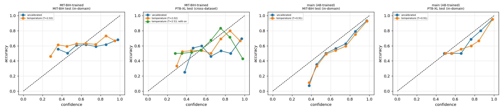

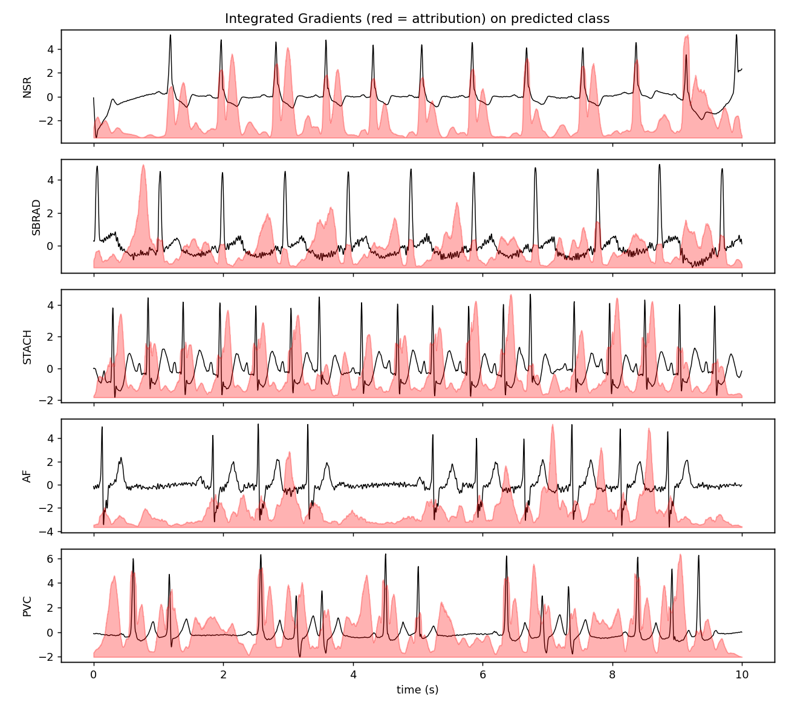

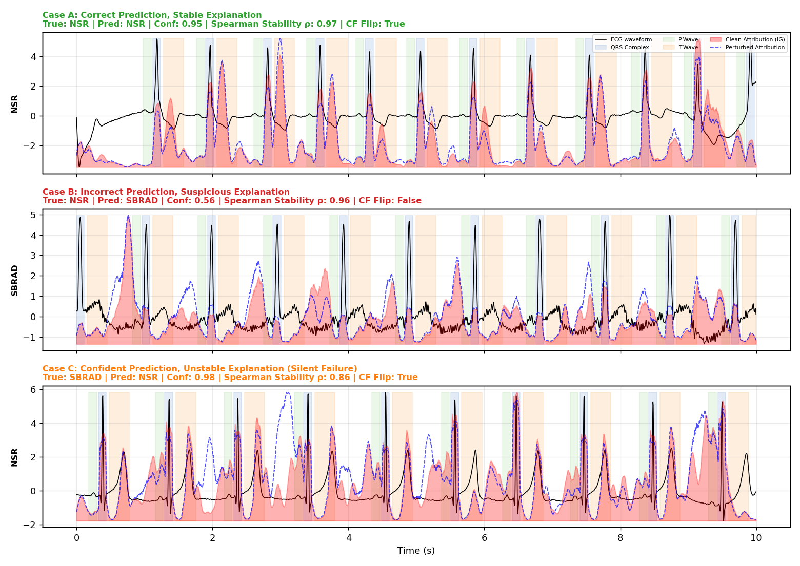

**Explanation metrics**

```
{
 "n_windows": 100,
 "ig_steps": 32,
 "completeness_gap": 0.004422451369464397,
 "spearman": 0.9508713150859706,
 "topk_jaccard": 0.7462605981850539,
 "deletion_auc_ig": 0.4447232484817505,
 "deletion_auc_random": 0.6679324299097061,
 "insertion_auc_ig": 0.4876154690980911,
 "insertion_auc_random": 0.30508048087358475,
 "failure_mode_counts": {
  "Case A: Correct, stable explanation": 73,
  "Case D: Standard / intermediate": 27
 },
 "error_warning_auroc": {
  "auroc_confidence_only": 0.6688000000000001,
  "auroc_explanation_instability_only": 0.6565333333333333,
  "auroc_combined_warning": 0.7552,
  "auroc_gain_over_confidence": 0.08639999999999992
 }
}
```

## 4. Noise robustness and rejection (remark 4 & Improvement 3)
Improvement 3 compares 5 abstention policies (SQI-only, Uncertainty-only, Fixed Dual-Gate, Val-Calibrated Dual Gate, and Adaptive Reliability Policy) across complete risk-coverage trade-off curves, abnormal rhythm sensitivity, and cross-noise transfer.

**Performance vs. noise type and SNR**

| noise | snr_db | macro_f1_resnet_ens | macro_f1_resnet_seed0 | macro_f1_cnn1d | macro_f1_resnet_nofilter | ece | reject_rate | reject_rate_uncertainty_only | reject_rate_quality_only | macro_f1_accepted | acc_accepted | acc_rejected | acc_all |
|---|---|---|---|---|---|---|---|---|---|---|---|---|---|
| clean |  | 0.776 | 0.746 | 0.608 | 0.828 | 0.070 | 0.086 | 0.048 | 0.045 | 0.794 | 0.848 | 0.601 | 0.827 |
| bw | 24.000 | 0.776 | 0.745 | 0.608 | 0.829 | 0.070 | 0.087 | 0.048 | 0.045 | 0.794 | 0.848 | 0.603 | 0.827 |
| bw | 18.000 | 0.775 | 0.747 | 0.608 | 0.826 | 0.072 | 0.087 | 0.048 | 0.045 | 0.793 | 0.848 | 0.603 | 0.827 |
| bw | 12.000 | 0.774 | 0.746 | 0.609 | 0.824 | 0.073 | 0.090 | 0.051 | 0.045 | 0.793 | 0.847 | 0.600 | 0.825 |
| bw | 6.000 | 0.776 | 0.744 | 0.598 | 0.805 | 0.068 | 0.091 | 0.053 | 0.045 | 0.794 | 0.848 | 0.607 | 0.826 |
| bw | 0.000 | 0.762 | 0.717 | 0.593 | 0.774 | 0.072 | 0.106 | 0.067 | 0.050 | 0.788 | 0.841 | 0.582 | 0.813 |
| bw | -6.000 | 0.726 | 0.679 | 0.578 | 0.657 | 0.088 | 0.178 | 0.097 | 0.102 | 0.766 | 0.823 | 0.585 | 0.781 |
| em | 24.000 | 0.770 | 0.733 | 0.596 | 0.829 | 0.076 | 0.093 | 0.055 | 0.045 | 0.786 | 0.842 | 0.608 | 0.820 |
| em | 18.000 | 0.763 | 0.703 | 0.584 | 0.822 | 0.073 | 0.105 | 0.069 | 0.044 | 0.787 | 0.841 | 0.564 | 0.812 |
| em | 12.000 | 0.723 | 0.667 | 0.556 | 0.811 | 0.088 | 0.128 | 0.095 | 0.042 | 0.757 | 0.813 | 0.506 | 0.774 |
| em | 6.000 | 0.640 | 0.614 | 0.497 | 0.780 | 0.123 | 0.176 | 0.144 | 0.043 | 0.699 | 0.772 | 0.408 | 0.708 |
| em | 0.000 | 0.539 | 0.481 | 0.351 | 0.666 | 0.163 | 0.410 | 0.308 | 0.189 | 0.612 | 0.725 | 0.405 | 0.594 |
| em | -6.000 | 0.266 | 0.231 | 0.154 | 0.406 | 0.338 | 0.799 | 0.574 | 0.550 | 0.296 | 0.471 | 0.298 | 0.333 |
| ma | 24.000 | 0.776 | 0.744 | 0.612 | 0.826 | 0.075 | 0.091 | 0.052 | 0.045 | 0.794 | 0.849 | 0.604 | 0.827 |
| ma | 18.000 | 0.775 | 0.736 | 0.612 | 0.821 | 0.076 | 0.092 | 0.053 | 0.046 | 0.793 | 0.847 | 0.616 | 0.826 |
| ma | 12.000 | 0.771 | 0.721 | 0.608 | 0.814 | 0.067 | 0.105 | 0.061 | 0.054 | 0.795 | 0.850 | 0.592 | 0.823 |
| ma | 6.000 | 0.748 | 0.671 | 0.602 | 0.803 | 0.069 | 0.157 | 0.089 | 0.082 | 0.800 | 0.852 | 0.543 | 0.803 |
| ma | 0.000 | 0.663 | 0.560 | 0.551 | 0.773 | 0.111 | 0.442 | 0.154 | 0.352 | 0.738 | 0.824 | 0.605 | 0.727 |
| ma | -6.000 | 0.496 | 0.345 | 0.394 | 0.611 | 0.214 | 0.837 | 0.328 | 0.771 | 0.736 | 0.829 | 0.509 | 0.561 |


**5-Policy Risk-Coverage and Macro-F1 Trade-off Curves**

| target_coverage | actual_coverage | error_rate | accuracy | macro_f1 | abnormal_recall | arrhythmia_fn_rate | clean_rejection_rate | rejection_rate | recall_nsr | recall_sbrad | recall_stach | recall_af | recall_pvc | policy |
|---|---|---|---|---|---|---|---|---|---|---|---|---|---|---|
| 0.400 | 0.400 | 0.129 | 0.871 | 0.847 | 0.902 | 0.098 | 0.405 | 0.600 | 0.898 | 0.840 | 1.000 | 1.000 | 0.612 | 1. SQI Gate Only |
| 0.500 | 0.500 | 0.162 | 0.838 | 0.793 | 0.902 | 0.098 | 0.267 | 0.500 | 0.869 | 0.808 | 0.997 | 0.999 | 0.603 | 1. SQI Gate Only |
| 0.600 | 0.600 | 0.177 | 0.823 | 0.776 | 0.903 | 0.097 | 0.168 | 0.400 | 0.850 | 0.813 | 0.978 | 0.998 | 0.580 | 1. SQI Gate Only |
| 0.700 | 0.700 | 0.198 | 0.802 | 0.755 | 0.902 | 0.098 | 0.111 | 0.300 | 0.829 | 0.796 | 0.921 | 0.996 | 0.551 | 1. SQI Gate Only |
| 0.800 | 0.800 | 0.220 | 0.780 | 0.731 | 0.903 | 0.097 | 0.070 | 0.200 | 0.802 | 0.779 | 0.826 | 0.995 | 0.524 | 1. SQI Gate Only |
| 0.850 | 0.851 | 0.230 | 0.770 | 0.721 | 0.903 | 0.097 | 0.051 | 0.149 | 0.790 | 0.770 | 0.772 | 0.995 | 0.518 | 1. SQI Gate Only |
| 0.900 | 0.900 | 0.233 | 0.767 | 0.718 | 0.904 | 0.096 | 0.024 | 0.100 | 0.787 | 0.768 | 0.754 | 0.995 | 0.515 | 1. SQI Gate Only |
| 0.950 | 0.950 | 0.233 | 0.767 | 0.717 | 0.905 | 0.095 | 0.002 | 0.050 | 0.790 | 0.768 | 0.746 | 0.995 | 0.504 | 1. SQI Gate Only |
| 1.000 | 1.000 | 0.246 | 0.754 | 0.706 | 0.907 | 0.093 | 0.000 | 0.000 | 0.777 | 0.757 | 0.725 | 0.995 | 0.481 | 1. SQI Gate Only |
| 0.400 | 0.400 | 0.044 | 0.956 | 0.877 | 0.937 | 0.063 | 0.502 | 0.600 | 0.993 | 0.645 | 0.743 | 1.000 | 0.667 | 2. Uncertainty Gate Only |
| 0.500 | 0.500 | 0.075 | 0.925 | 0.856 | 0.904 | 0.096 | 0.388 | 0.500 | 0.987 | 0.657 | 0.781 | 1.000 | 0.576 | 2. Uncertainty Gate Only |
| 0.600 | 0.600 | 0.100 | 0.900 | 0.848 | 0.902 | 0.098 | 0.286 | 0.400 | 0.967 | 0.721 | 0.772 | 1.000 | 0.609 | 2. Uncertainty Gate Only |
| 0.700 | 0.700 | 0.126 | 0.874 | 0.821 | 0.910 | 0.090 | 0.194 | 0.300 | 0.938 | 0.773 | 0.760 | 1.000 | 0.589 | 2. Uncertainty Gate Only |
| 0.800 | 0.800 | 0.164 | 0.836 | 0.782 | 0.912 | 0.088 | 0.114 | 0.200 | 0.895 | 0.781 | 0.748 | 1.000 | 0.552 | 2. Uncertainty Gate Only |
| 0.850 | 0.850 | 0.181 | 0.819 | 0.764 | 0.912 | 0.088 | 0.069 | 0.150 | 0.871 | 0.784 | 0.740 | 0.999 | 0.536 | 2. Uncertainty Gate Only |
| 0.900 | 0.900 | 0.203 | 0.797 | 0.742 | 0.908 | 0.092 | 0.036 | 0.100 | 0.843 | 0.780 | 0.730 | 0.999 | 0.514 | 2. Uncertainty Gate Only |
| 0.950 | 0.950 | 0.223 | 0.777 | 0.725 | 0.907 | 0.093 | 0.015 | 0.050 | 0.812 | 0.772 | 0.732 | 0.998 | 0.497 | 2. Uncertainty Gate Only |
| 1.000 | 1.000 | 0.246 | 0.754 | 0.706 | 0.907 | 0.093 | 0.000 | 0.000 | 0.777 | 0.757 | 0.725 | 0.995 | 0.481 | 2. Uncertainty Gate Only |
| 0.400 | 0.781 | 0.172 | 0.828 | 0.772 | 0.903 | 0.097 | 0.086 | 0.219 | 0.880 | 0.790 | 0.799 | 0.999 | 0.557 | 3. Fixed Dual-Gate (Baseline) |
| 0.500 | 0.781 | 0.172 | 0.828 | 0.772 | 0.903 | 0.097 | 0.086 | 0.219 | 0.880 | 0.790 | 0.799 | 0.999 | 0.557 | 3. Fixed Dual-Gate (Baseline) |
| 0.600 | 0.781 | 0.172 | 0.828 | 0.772 | 0.903 | 0.097 | 0.086 | 0.219 | 0.880 | 0.790 | 0.799 | 0.999 | 0.557 | 3. Fixed Dual-Gate (Baseline) |
| 0.700 | 0.781 | 0.172 | 0.828 | 0.772 | 0.903 | 0.097 | 0.086 | 0.219 | 0.880 | 0.790 | 0.799 | 0.999 | 0.557 | 3. Fixed Dual-Gate (Baseline) |
| 0.800 | 0.781 | 0.172 | 0.828 | 0.772 | 0.903 | 0.097 | 0.086 | 0.219 | 0.880 | 0.790 | 0.799 | 0.999 | 0.557 | 3. Fixed Dual-Gate (Baseline) |
| 0.850 | 0.781 | 0.172 | 0.828 | 0.772 | 0.903 | 0.097 | 0.086 | 0.219 | 0.880 | 0.790 | 0.799 | 0.999 | 0.557 | 3. Fixed Dual-Gate (Baseline) |
| 0.900 | 0.781 | 0.172 | 0.828 | 0.772 | 0.903 | 0.097 | 0.086 | 0.219 | 0.880 | 0.790 | 0.799 | 0.999 | 0.557 | 3. Fixed Dual-Gate (Baseline) |
| 0.950 | 0.781 | 0.172 | 0.828 | 0.772 | 0.903 | 0.097 | 0.086 | 0.219 | 0.880 | 0.790 | 0.799 | 0.999 | 0.557 | 3. Fixed Dual-Gate (Baseline) |
| 1.000 | 0.781 | 0.172 | 0.828 | 0.772 | 0.903 | 0.097 | 0.086 | 0.219 | 0.880 | 0.790 | 0.799 | 0.999 | 0.557 | 3. Fixed Dual-Gate (Baseline) |
| 0.400 | 0.400 | 0.076 | 0.924 | 0.896 | 0.902 | 0.098 | 0.415 | 0.600 | 0.984 | 0.752 | 0.983 | 1.000 | 0.691 | 4. Val-Calibrated Dual Gate |
| 0.500 | 0.500 | 0.093 | 0.907 | 0.873 | 0.903 | 0.097 | 0.314 | 0.500 | 0.971 | 0.771 | 0.952 | 1.000 | 0.670 | 4. Val-Calibrated Dual Gate |
| 0.600 | 0.600 | 0.121 | 0.879 | 0.834 | 0.905 | 0.095 | 0.230 | 0.400 | 0.941 | 0.789 | 0.869 | 1.000 | 0.619 | 4. Val-Calibrated Dual Gate |
| 0.700 | 0.700 | 0.154 | 0.846 | 0.795 | 0.908 | 0.092 | 0.156 | 0.300 | 0.906 | 0.788 | 0.803 | 0.999 | 0.584 | 4. Val-Calibrated Dual Gate |
| 0.800 | 0.800 | 0.182 | 0.818 | 0.763 | 0.906 | 0.094 | 0.070 | 0.200 | 0.867 | 0.790 | 0.768 | 0.999 | 0.554 | 4. Val-Calibrated Dual Gate |
| 0.850 | 0.850 | 0.197 | 0.803 | 0.749 | 0.905 | 0.095 | 0.040 | 0.150 | 0.844 | 0.785 | 0.761 | 0.999 | 0.538 | 4. Val-Calibrated Dual Gate |
| 0.900 | 0.900 | 0.212 | 0.788 | 0.735 | 0.904 | 0.096 | 0.015 | 0.100 | 0.823 | 0.780 | 0.751 | 0.998 | 0.523 | 4. Val-Calibrated Dual Gate |
| 0.950 | 0.950 | 0.229 | 0.771 | 0.720 | 0.905 | 0.095 | 0.001 | 0.050 | 0.797 | 0.772 | 0.746 | 0.997 | 0.504 | 4. Val-Calibrated Dual Gate |
| 1.000 | 1.000 | 0.246 | 0.754 | 0.706 | 0.907 | 0.093 | 0.000 | 0.000 | 0.777 | 0.757 | 0.725 | 0.995 | 0.481 | 4. Val-Calibrated Dual Gate |
| 0.400 | 0.400 | 0.064 | 0.936 | 0.905 | 0.998 | 0.002 | 0.463 | 0.600 | 0.929 | 0.986 | 0.798 | 1.000 | 0.754 | 5. Adaptive Reliability Policy (SmartPace) |
| 0.500 | 0.500 | 0.081 | 0.919 | 0.879 | 0.982 | 0.018 | 0.345 | 0.500 | 0.935 | 0.947 | 0.780 | 1.000 | 0.701 | 5. Adaptive Reliability Policy (SmartPace) |
| 0.600 | 0.600 | 0.115 | 0.885 | 0.839 | 0.949 | 0.051 | 0.249 | 0.400 | 0.924 | 0.857 | 0.768 | 1.000 | 0.643 | 5. Adaptive Reliability Policy (SmartPace) |
| 0.700 | 0.700 | 0.145 | 0.855 | 0.803 | 0.934 | 0.066 | 0.159 | 0.300 | 0.902 | 0.825 | 0.762 | 0.999 | 0.593 | 5. Adaptive Reliability Policy (SmartPace) |
| 0.800 | 0.800 | 0.176 | 0.824 | 0.769 | 0.926 | 0.074 | 0.081 | 0.200 | 0.868 | 0.811 | 0.748 | 0.999 | 0.552 | 5. Adaptive Reliability Policy (SmartPace) |
| 0.850 | 0.850 | 0.194 | 0.806 | 0.751 | 0.918 | 0.082 | 0.049 | 0.150 | 0.848 | 0.797 | 0.734 | 0.999 | 0.532 | 5. Adaptive Reliability Policy (SmartPace) |
| 0.900 | 0.900 | 0.211 | 0.789 | 0.736 | 0.913 | 0.087 | 0.025 | 0.100 | 0.824 | 0.786 | 0.729 | 0.998 | 0.516 | 5. Adaptive Reliability Policy (SmartPace) |
| 0.950 | 0.950 | 0.228 | 0.772 | 0.721 | 0.909 | 0.091 | 0.005 | 0.050 | 0.800 | 0.774 | 0.726 | 0.998 | 0.497 | 5. Adaptive Reliability Policy (SmartPace) |
| 1.000 | 1.000 | 0.246 | 0.754 | 0.706 | 0.907 | 0.093 | 0.000 | 0.000 | 0.777 | 0.757 | 0.725 | 0.995 | 0.481 | 5. Adaptive Reliability Policy (SmartPace) |


**Rejection Rates across Noise Types and SNR Levels**

| noise_kind | snr_db | rejection_rate | n_samples | policy |
|---|---|---|---|---|
| bw | -6.000 | 0.158 | 2000 | 3. Fixed Dual-Gate (Baseline) |
| bw | 0.000 | 0.087 | 2000 | 3. Fixed Dual-Gate (Baseline) |
| bw | 6.000 | 0.079 | 2000 | 3. Fixed Dual-Gate (Baseline) |
| bw | 12.000 | 0.076 | 2000 | 3. Fixed Dual-Gate (Baseline) |
| bw | 18.000 | 0.077 | 2000 | 3. Fixed Dual-Gate (Baseline) |
| bw | 24.000 | 0.077 | 2000 | 3. Fixed Dual-Gate (Baseline) |
| em | -6.000 | 0.766 | 2000 | 3. Fixed Dual-Gate (Baseline) |
| em | 0.000 | 0.368 | 2000 | 3. Fixed Dual-Gate (Baseline) |
| em | 6.000 | 0.141 | 2000 | 3. Fixed Dual-Gate (Baseline) |
| em | 12.000 | 0.104 | 2000 | 3. Fixed Dual-Gate (Baseline) |
| em | 18.000 | 0.085 | 2000 | 3. Fixed Dual-Gate (Baseline) |
| em | 24.000 | 0.080 | 2000 | 3. Fixed Dual-Gate (Baseline) |
| ma | -6.000 | 0.826 | 2000 | 3. Fixed Dual-Gate (Baseline) |
| ma | 0.000 | 0.418 | 2000 | 3. Fixed Dual-Gate (Baseline) |
| ma | 6.000 | 0.135 | 2000 | 3. Fixed Dual-Gate (Baseline) |
| ma | 12.000 | 0.091 | 2000 | 3. Fixed Dual-Gate (Baseline) |
| ma | 18.000 | 0.080 | 2000 | 3. Fixed Dual-Gate (Baseline) |
| ma | 24.000 | 0.076 | 2000 | 3. Fixed Dual-Gate (Baseline) |
| clean |  | 0.077 | 2000 | 3. Fixed Dual-Gate (Baseline) |
| bw | -6.000 | 0.242 | 2000 | 4. Val-Calibrated Dual Gate |
| bw | 0.000 | 0.115 | 2000 | 4. Val-Calibrated Dual Gate |
| bw | 6.000 | 0.082 | 2000 | 4. Val-Calibrated Dual Gate |
| bw | 12.000 | 0.072 | 2000 | 4. Val-Calibrated Dual Gate |
| bw | 18.000 | 0.069 | 2000 | 4. Val-Calibrated Dual Gate |
| bw | 24.000 | 0.069 | 2000 | 4. Val-Calibrated Dual Gate |
| em | -6.000 | 0.580 | 2000 | 4. Val-Calibrated Dual Gate |
| em | 0.000 | 0.317 | 2000 | 4. Val-Calibrated Dual Gate |
| em | 6.000 | 0.157 | 2000 | 4. Val-Calibrated Dual Gate |
| em | 12.000 | 0.113 | 2000 | 4. Val-Calibrated Dual Gate |
| em | 18.000 | 0.087 | 2000 | 4. Val-Calibrated Dual Gate |
| em | 24.000 | 0.075 | 2000 | 4. Val-Calibrated Dual Gate |
| ma | -6.000 | 0.904 | 2000 | 4. Val-Calibrated Dual Gate |
| ma | 0.000 | 0.463 | 2000 | 4. Val-Calibrated Dual Gate |
| ma | 6.000 | 0.144 | 2000 | 4. Val-Calibrated Dual Gate |
| ma | 12.000 | 0.091 | 2000 | 4. Val-Calibrated Dual Gate |
| ma | 18.000 | 0.077 | 2000 | 4. Val-Calibrated Dual Gate |
| ma | 24.000 | 0.073 | 2000 | 4. Val-Calibrated Dual Gate |
| clean |  | 0.070 | 2000 | 4. Val-Calibrated Dual Gate |
| bw | -6.000 | 0.230 | 2000 | 5. Adaptive Reliability Policy (SmartPace) |
| bw | 0.000 | 0.134 | 2000 | 5. Adaptive Reliability Policy (SmartPace) |
| bw | 6.000 | 0.091 | 2000 | 5. Adaptive Reliability Policy (SmartPace) |
| bw | 12.000 | 0.084 | 2000 | 5. Adaptive Reliability Policy (SmartPace) |
| bw | 18.000 | 0.081 | 2000 | 5. Adaptive Reliability Policy (SmartPace) |
| bw | 24.000 | 0.082 | 2000 | 5. Adaptive Reliability Policy (SmartPace) |
| em | -6.000 | 0.647 | 2000 | 5. Adaptive Reliability Policy (SmartPace) |
| em | 0.000 | 0.435 | 2000 | 5. Adaptive Reliability Policy (SmartPace) |
| em | 6.000 | 0.204 | 2000 | 5. Adaptive Reliability Policy (SmartPace) |
| em | 12.000 | 0.144 | 2000 | 5. Adaptive Reliability Policy (SmartPace) |
| em | 18.000 | 0.103 | 2000 | 5. Adaptive Reliability Policy (SmartPace) |
| em | 24.000 | 0.087 | 2000 | 5. Adaptive Reliability Policy (SmartPace) |
| ma | -6.000 | 0.629 | 2000 | 5. Adaptive Reliability Policy (SmartPace) |
| ma | 0.000 | 0.358 | 2000 | 5. Adaptive Reliability Policy (SmartPace) |
| ma | 6.000 | 0.152 | 2000 | 5. Adaptive Reliability Policy (SmartPace) |
| ma | 12.000 | 0.095 | 2000 | 5. Adaptive Reliability Policy (SmartPace) |
| ma | 18.000 | 0.083 | 2000 | 5. Adaptive Reliability Policy (SmartPace) |
| ma | 24.000 | 0.080 | 2000 | 5. Adaptive Reliability Policy (SmartPace) |
| clean |  | 0.081 | 2000 | 5. Adaptive Reliability Policy (SmartPace) |


**Cross-Noise Transfer Generalization Evaluation**

| calibrated_on | tested_on | target_noise_name | achieved_coverage | error_rate | macro_f1 | abnormal_recall | arrhythmia_fn_rate |
|---|---|---|---|---|---|---|---|
| ma | bw | Baseline wander | 0.863 | 0.139 | 0.806 | 0.917 | 0.083 |
| ma | em | Electrode motion | 0.702 | 0.229 | 0.720 | 0.942 | 0.058 |
| ma | ma | Muscle artifact | 0.745 | 0.151 | 0.791 | 0.930 | 0.070 |
| em | bw | Baseline wander | 0.900 | 0.151 | 0.794 | 0.911 | 0.089 |
| em | em | Electrode motion | 0.755 | 0.246 | 0.703 | 0.938 | 0.062 |
| em | ma | Muscle artifact | 0.786 | 0.165 | 0.776 | 0.924 | 0.076 |

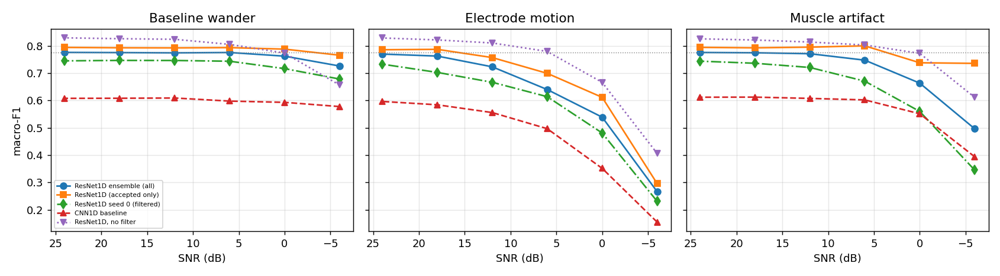

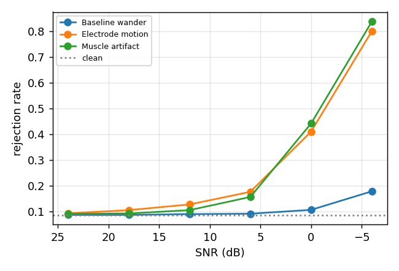

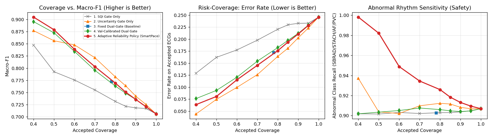

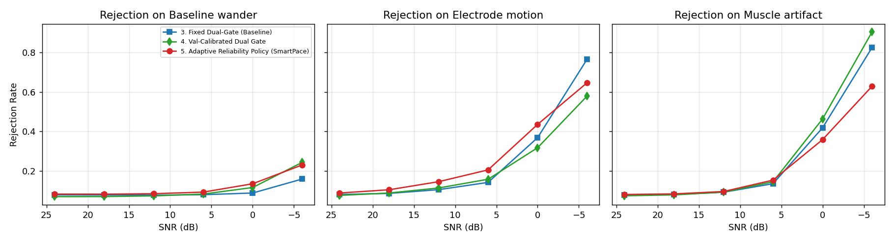

## 5. Edge model benchmark (remark 5 & Improvement 5)
Improvement 5 evaluates the reliability-resource trade-off: latency, file size, and peak memory benchmarked against calibration (ECE, Brier score), signed confidence distortion, and abstention discordance.

**FP32 vs INT8 vs Pruned Performance and Resource Profile**

| variant | params | nonzero_params | sparsity | file_mb | gzip_mb | lat_mean_ms | lat_median_ms | lat_p95_ms | peak_rss_mb | model_rss_delta_mb | macro_f1 | accuracy | ece | brier | mean_confidence | same_pred_agreement | mean_abs_conf_shift | p95_abs_conf_shift | signed_conf_shift | conf_shift_on_same_pred | abstention_discordance_rate | coverage_at_tau | error_rate_at_tau | recall_nsr | recall_sbrad | recall_stach | recall_af | recall_pvc |
|---|---|---|---|---|---|---|---|---|---|---|---|---|---|---|---|---|---|---|---|---|---|---|---|---|---|---|---|---|
| resnet1d_fp32 | 206197 | 206197 | 0.000 | 0.830 | 0.764 | 1.681 | 1.678 | 1.708 | 62.423 | 6.988 | 0.750 | 0.785 | 0.105 | 0.318 | 0.882 | 1.000 | 0.000 | 0.000 | 0.000 | 0.000 | 0.000 | 0.733 | 0.100 | 0.836 | 0.815 | 0.752 | 1.000 | 0.448 |
| resnet1d_finetuned_fp32 (control, no pruning) | 206197 | 206197 | 0.000 | 0.830 | 0.764 | 1.713 | 1.725 | 1.766 | 62.570 | 7.053 | 0.835 | 0.846 | 0.051 | 0.246 | 0.897 | 0.887 | 0.095 | 0.397 | 0.015 | 0.080 | 0.217 | 0.759 | 0.078 | 0.837 | 0.787 | 0.743 | 0.992 | 0.813 |
| cnn1d_fp32 (baseline B1) | 25925 | 25925 | 0.000 | 0.105 | 0.096 | 0.156 | 0.154 | 0.165 | 61.288 | 5.730 | 0.623 | 0.738 | 0.050 | 0.358 | 0.786 | 0.784 | 0.157 | 0.463 | -0.097 | 0.137 | 0.377 | 0.463 | 0.065 | 0.740 | 0.757 | 0.079 | 0.956 | 0.616 |
| resnet1d_int8 | 206197 | 206197 | 0.000 | 0.259 | 0.211 | 0.714 | 0.698 | 0.793 | 62.738 | 7.467 | 0.742 | 0.777 | 0.099 | 0.330 | 0.872 | 0.982 | 0.022 | 0.078 | -0.011 | 0.021 | 0.038 | 0.708 | 0.106 | 0.835 | 0.815 | 0.752 | 0.997 | 0.410 |
| resnet1d_pruned50_fp32 | 206197 | 103901 | 0.496 | 0.830 | 0.469 | 1.771 | 1.765 | 1.810 | 62.185 | 7.066 | 0.843 | 0.854 | 0.041 | 0.236 | 0.886 | 0.870 | 0.108 | 0.425 | 0.004 | 0.092 | 0.263 | 0.720 | 0.074 | 0.870 | 0.704 | 0.723 | 0.993 | 0.857 |
| resnet1d_pruned50_int8 | 206197 | 103901 | 0.496 | 0.259 | 0.153 | 0.730 | 0.708 | 0.903 | 62.841 | 7.283 | 0.837 | 0.849 | 0.046 | 0.244 | 0.855 | 0.861 | 0.127 | 0.445 | -0.027 | 0.112 | 0.302 | 0.654 | 0.072 | 0.866 | 0.685 | 0.703 | 0.985 | 0.869 |
| resnet1d_pruned80_fp32 | 206197 | 42523 | 0.794 | 0.830 | 0.244 | 1.739 | 1.734 | 1.815 | 62.218 | 7.098 | 0.844 | 0.854 | 0.036 | 0.229 | 0.878 | 0.865 | 0.115 | 0.415 | -0.004 | 0.100 | 0.285 | 0.698 | 0.067 | 0.873 | 0.731 | 0.693 | 0.970 | 0.853 |
| resnet1d_pruned80_int8 | 206197 | 42523 | 0.794 | 0.259 | 0.086 | 0.695 | 0.694 | 0.704 | 62.943 | 7.430 | 0.827 | 0.837 | 0.030 | 0.250 | 0.849 | 0.853 | 0.139 | 0.439 | -0.033 | 0.124 | 0.360 | 0.610 | 0.073 | 0.861 | 0.738 | 0.693 | 0.887 | 0.854 |


**Edge Calibration and Confidence Distortion Analysis**

| variant | macro_f1 | ece | brier | same_pred_agreement | mean_abs_conf_shift | p95_abs_conf_shift | signed_conf_shift | conf_shift_on_same_pred | abstention_discordance_rate | coverage_at_tau | error_rate_at_tau |
|---|---|---|---|---|---|---|---|---|---|---|---|
| resnet1d_fp32 | 0.750 | 0.105 | 0.318 | 1.000 | 0.000 | 0.000 | 0.000 | 0.000 | 0.000 | 0.733 | 0.100 |
| resnet1d_finetuned_fp32 (control, no pruning) | 0.835 | 0.051 | 0.246 | 0.887 | 0.095 | 0.397 | 0.015 | 0.080 | 0.217 | 0.759 | 0.078 |
| cnn1d_fp32 (baseline B1) | 0.623 | 0.050 | 0.358 | 0.784 | 0.157 | 0.463 | -0.097 | 0.137 | 0.377 | 0.463 | 0.065 |
| resnet1d_int8 | 0.742 | 0.099 | 0.330 | 0.982 | 0.022 | 0.078 | -0.011 | 0.021 | 0.038 | 0.708 | 0.106 |
| resnet1d_pruned50_fp32 | 0.843 | 0.041 | 0.236 | 0.870 | 0.108 | 0.425 | 0.004 | 0.092 | 0.263 | 0.720 | 0.074 |
| resnet1d_pruned50_int8 | 0.837 | 0.046 | 0.244 | 0.861 | 0.127 | 0.445 | -0.027 | 0.112 | 0.302 | 0.654 | 0.072 |
| resnet1d_pruned80_fp32 | 0.844 | 0.036 | 0.229 | 0.865 | 0.115 | 0.415 | -0.004 | 0.100 | 0.285 | 0.698 | 0.067 |
| resnet1d_pruned80_int8 | 0.827 | 0.030 | 0.250 | 0.853 | 0.139 | 0.439 | -0.033 | 0.124 | 0.360 | 0.610 | 0.073 |

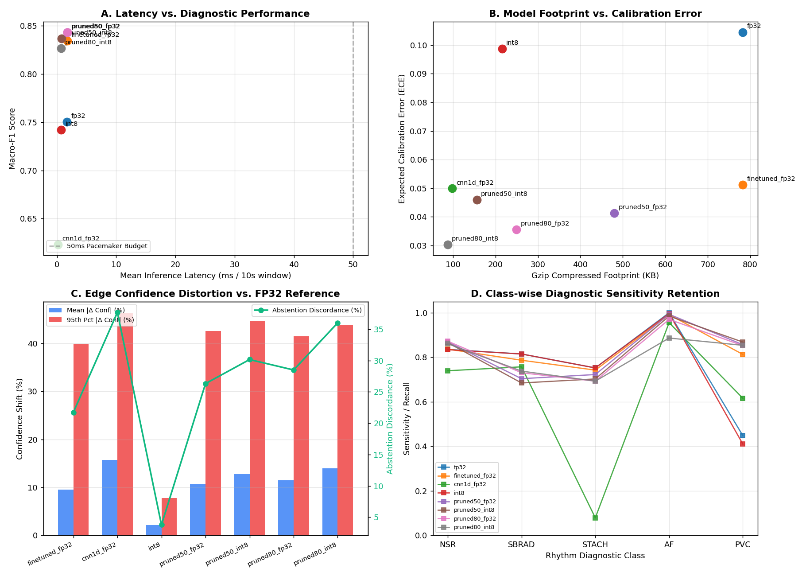

## 6. SIMULATED decision support (remark 6)
False triggers are counted as events per hour of replayed recording; delay is the time from episode start to the first correct simulated action.

**Policy comparison**

| scenario | policy | false_triggers_per_hour | false_triggers_strict_per_hour | episodes | missed_episode_rate | delay_mean_s | delay_median_s | window_sensitivity | window_false_alert_rate | window_false_alert_rate_strict | unreliable_time_frac |
|---|---|---|---|---|---|---|---|---|---|---|---|
| clean | fixed: heart-rate rule | 15.969 | 26.131 | 394 | 0.505 | 13.590 | 0.000 | 0.526 | 0.071 | 0.085 | 0.000 |
| clean | fixed: heart-rate + R-R irregularity rule | 12.581 | 24.389 | 394 | 0.084 | 1.066 | 0.000 | 0.866 | 0.183 | 0.196 | 0.000 |
| clean | SmartPace policy (no reject) | 3.968 | 12.872 | 394 | 0.264 | 0.405 | 0.000 | 0.896 | 0.140 | 0.150 | 0.000 |
| clean | SmartPace policy (+ uncertainty/quality reject) | 10.452 | 16.743 | 394 | 0.358 | 1.364 | 0.000 | 0.824 | 0.093 | 0.094 | 0.097 |
| noisy_bursts | fixed: heart-rate rule | 17.033 | 27.292 | 394 | 0.497 | 13.359 | 0.000 | 0.525 | 0.073 | 0.087 | 0.000 |
| noisy_bursts | fixed: heart-rate + R-R irregularity rule | 15.291 | 27.873 | 394 | 0.084 | 0.907 | 0.000 | 0.870 | 0.195 | 0.207 | 0.000 |
| noisy_bursts | SmartPace policy (no reject) | 7.839 | 19.550 | 394 | 0.251 | 0.958 | 0.000 | 0.897 | 0.159 | 0.173 | 0.000 |
| noisy_bursts | SmartPace policy (+ uncertainty/quality reject) | 13.549 | 20.614 | 394 | 0.365 | 1.800 | 0.000 | 0.780 | 0.090 | 0.093 | 0.150 |

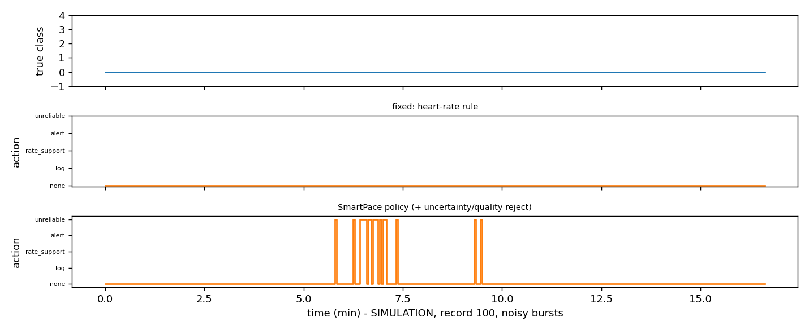
